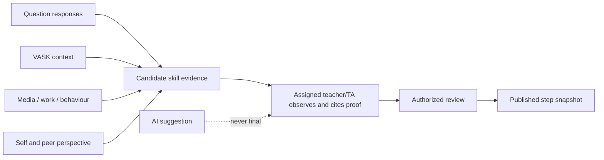

# SRS-08 Assessment, eight skills and sixteen steps

## 1. Purpose

Record evidence-backed observations against eight framework skills and their 16 reference steps while preserving different perspectives and human authority.

## 2. Fixed framework model

| Rule | Value |
|---|---|
| Skills | Exactly 8, displayed in approved order 1–8 |
| Steps per skill | Exactly 16, integer 1–16 |
| Development display bands | 1–4 entry; 5–8 intermediate; 9–12 advanced; 13–16 mastery |
| Consistency rating | Integer 1–6 |
| Supplied questionnaire scale | Integer 1–6 |

Development bands are display groupings, not separate marks.

## 3. Functional requirements

| ID | Requirement | Status | Phase |
|---|---|---|---|
| ASM-FR-001 | The system shall store framework, skill and step definitions as versioned reference data. | Confirmed architecture | P1 |
| ASM-FR-002 | An observation shall identify student, activity, author, perspective, skill, observed step, consistency, time, comment and evidence links. | Confirmed architecture | P1 |
| ASM-FR-003 | Observed step and consistency shall remain separate numeric values. | Confirmed architecture | P1 |
| ASM-FR-004 | Self, peer, teacher and external/professional perspectives shall remain separate source records. | Confirmed M-07 direction | P1 |
| ASM-FR-005 | Missing evidence or rating shall produce a missing/unconfirmed state, not zero. | Confirmed M-11/H-04 recommendation | P0 |
| ASM-FR-006 | A questionnaire mapping, VASK selection, academic mark, certificate or AI output shall not automatically publish a step. | Confirmed working model | P0 |
| ASM-FR-007 | Teacher/TA human confirmation is required by the current architecture before activity evidence changes a published step. | Recommended; final authority H-03/H-04 open | P1 |
| ASM-FR-008 | Academic marks may be supporting evidence only and must use a named grading scheme. | Confirmed working model | P1 |
| ASM-FR-009 | Published step decisions shall cite the evidence and authority/source instrument used. | Confirmed architecture | P1 |
| ASM-FR-010 | The formula for aggregating observations into a current step, including caps/thresholds/decay, shall not be implemented until approved. | Policy TBD H-03/M-07 | P1 |

## 4. Observation field contract

| Field | Required | Range |
|---|---|---|
| Skill | Yes | One of exactly 8 active skills |
| Observed step | Conditional | Integer 1–16; null means not rated |
| Consistency | Conditional with observed step | Integer 1–6 |
| Confidence | Optional | Configured enum, not a substitute for consistency |
| Comment | Required when used for progression | 1–4,000 characters |
| Evidence citations | Required when used for progression | 1–100 temporary cap |
| Suggested next step | Optional | Integer 1–16; normally ≥ observed step, exceptions require rationale |
| Source instrument | Required for formal use | 1–64 character code |

## 5. Evidence-to-publication flow

## 6. Provisional result display

- Candidate/unconfirmed evidence may be shown as such to authorized reviewers.
- Students see teacher answers, comments and skill results only after publication.
- Radar charts use a frozen published snapshot; live draft evidence shall not silently change the chart.
- A return for modification withdraws or supersedes the affected published result according to M-19; the prior version remains auditable.

## 7. Acceptance scenarios

- UI and API reject step 0, 17 and decimal steps with “Enter a whole number from 1 to 16.”
- A 1–6 response is not displayed as a 1–16 step.
- A missing teacher rating leaves self/peer evidence visible to reviewers but unconfirmed.
- One evidence item may support multiple skills, each with a separate observation.
- Recalculation cannot overwrite an issued historical snapshot.

