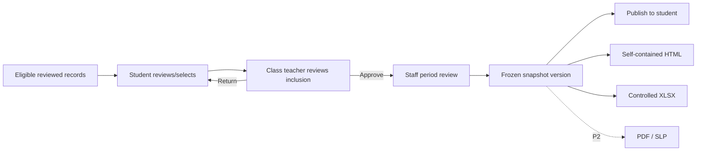

# SRS-09 Portfolio, Proud Moments and exports

## 1. Purpose

Publish a reproducible period view of a student's activities, feedback and evidence-backed development without exposing internal drafts or original media by default.

## 2. Functional requirements

| ID | Requirement | Status | Phase |
|---|---|---|---|
| PRT-FR-001 | A portfolio shall be published as a versioned snapshot for one student and reporting period. | Confirmed architecture | P1 |
| PRT-FR-002 | Snapshot items shall retain source type/ID, display section/order, inclusion decision and approving actor. | Confirmed architecture | P1 |
| PRT-FR-003 | The student and assigned class teacher shall review content before authorized staff publishes the snapshot. | Recommended architecture | P1 |
| PRT-FR-004 | Original media shall be hidden by default; the portfolio may show evidence references or attachment counts. | Confirmed M-18 | P1 |
| PRT-FR-005 | Proud Moments shall record a student's meaningful selection and reflection but shall not itself change a skill step. | Confirmed working model | P1 |
| PRT-FR-006 | Staff shall explicitly open and close the Proud Moments selection window; it shall never open automatically. | Confirmed POC direction | P0 |
| PRT-FR-007 | Publication and withdrawal shall be audited and shall preserve prior issued versions. | Confirmed M-19 | P1 |
| PRT-FR-008 | P1 shall support a self-contained HTML snapshot and controlled XLSX evidence register. PDF/SLP remains P2 pending H-01. | Recommended | P1/P2 |
| PRT-FR-009 | External recipients shall receive approved exports rather than platform accounts in P1. | Recommended H-09 | P1 |

## 3. Suggested portfolio sections

- Student and reporting-period identity
- Academic and non-academic activity history
- Published teacher feedback
- Eight-skill published snapshot and evidence references
- Student reflection, period review and outlook
- Proud Moments selected by the student and approved for publication
- Export provenance: snapshot version, approval and generation date

The official output combination remains Policy TBD H-01.

## 4. Proud Moments fields

| Field | Rule | Limit |
|---|---|---|
| Selection source | Required | Reviewed activity, external achievement or eligible evidence item |
| Reflection | Required | 1–4,000 characters; meaningful minimum TBD |
| Display order | Required | Integer 1–24 temporary cap |
| Maximum selections | Configurable | Temporary 24; final policy TBD |
| Publication status | Required | `unpublished`, `published_to_portfolio`, `withdrawn` |

## 5. Publication flow

## 6. Export controls

| Input | Maximum/status |
|---|---|
| Synchronous export rows | 50,000; larger jobs are asynchronous |
| Export filename | 255 characters |
| Export reason/recipient | 1–4,000 characters; required for external delivery |
| Download availability | Policy TBD L-07; use expiring authenticated access |
| Export package types | `self_contained_html`, `evidence_xlsx`; `pdf_slp` P2 |

Each export records snapshot version, generator, recipient category, filter/scope, file hash and timestamps.

## 7. Acceptance scenarios

- Publishing creates an immutable version while live activity data may continue changing.
- Withdrawing an item removes it from the current view but does not erase the issued history.
- Original media is absent from HTML/XLSX unless explicitly permitted by export policy.
- A Proud Moment remains a presentation/reflection choice and cannot promote a step.
- An external recipient cannot use the export link to browse the platform.

