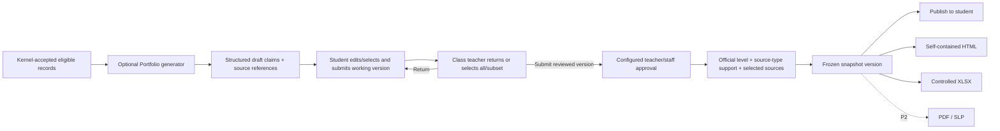

# SRS-09 Portfolio, Proud Moments and exports

## 1. Purpose

Publish a reproducible period view of a student's activities, feedback and evidence-backed development without exposing internal drafts or original media by default.

## 2. Functional requirements

| ID | Requirement | Status | Phase |
|---|---|---|---|
| PRT-FR-001 | A portfolio shall be published as a versioned snapshot for one student and reporting period. | Confirmed architecture | P1 |
| PRT-FR-002 | Snapshot items shall retain source type/ID, display section/order, inclusion decision and approving actor. | Confirmed architecture | P1 |
| PRT-FR-003 | The student and assigned class teacher shall review content before authorized staff publishes the snapshot. | Recommended architecture | P1 |
| PRT-FR-004 | Original media shall be hidden by default; the portfolio may show evidence references or attachment counts. | Confirmed M-18 | P1 |
| PRT-FR-005 | Proud Moments shall record a student's meaningful selection and reflection but shall not itself change a skill step. | Confirmed working model | P1 |
| PRT-FR-006 | Staff shall explicitly open and close the Proud Moments selection window; it shall never open automatically. | Confirmed POC direction | P0 |
| PRT-FR-007 | Publication and withdrawal shall be audited and shall preserve prior issued versions. | Confirmed M-19 | P1 |
| PRT-FR-008 | P1 shall support a self-contained HTML snapshot and controlled XLSX evidence register. PDF/SLP remains P2 pending H-01. | Recommended | P1/P2 |
| PRT-FR-009 | External recipients shall receive approved exports rather than platform accounts in P1. | Recommended H-09 | P1 |
| PRT-FR-010 | A Portfolio-generation job shall receive only evidence that the kernel has marked accepted and eligible for the selected student, school and period; raw provider output and rejected candidates shall be excluded. | Approved System Analyst architecture decision, 27 Oct 2026 | P1 contract/P2 provider |
| PRT-FR-011 | Generated output shall be a structured set of draft sections/claims with one or more ordered source references per evidence-based claim, generator/prompt metadata and warnings; every source reference must resolve to an item in the frozen input manifest. | Approved System Analyst architecture decision, 27 Oct 2026 | P1 contract/P2 provider |
| PRT-FR-012 | Visualization and export shall read only a human-approved, versioned snapshot DTO. They shall not invoke a generator or derive claims from raw evidence. | Approved System Analyst architecture decision, 27 Oct 2026 | P1 |
| PRT-FR-013 | Each published rubric/skill result shall retain the official level, rubric/version/axis, aggregation policy, included observation/proof links, reviewer rationale and a source-type breakdown containing each type's included maximum supported level or `not_enough_evidence`. Candidate maximums and excluded items remain review/audit data rather than published assessment values. | Approved System Analyst architecture decision, 27 Oct 2026 | P1 |
| PRT-FR-014 | The published Portfolio may show the official level and privacy-filtered selected source references grouped by type. Excluded sources, rejected model alternatives and internal reasons remain visible only to authorized reviewers unless policy explicitly permits wider disclosure. | Approved System Analyst architecture decision, 27 Oct 2026 | P1 |
| PRT-FR-015 | If a source used by the current snapshot is later excluded, corrected or invalidated, the snapshot shall become `stale`/`needs_review` and its current publication shall be withdrawn pending explicit review and successor publication. The issued version remains reproducible. | Approved System Analyst architecture decision, 27 Oct 2026 | P1 |
| PRT-FR-016 | A successor snapshot/export shall identify the version it supersedes and the correction reason without silently altering any previously issued file. | Approved System Analyst architecture decision, 27 Oct 2026 | P1 |
| PRT-FR-017 | The system shall maintain immutable Portfolio working versions separately from published snapshots. Student editing/submission, class-teacher review, staff approval and publication are independent states/actions. | Approved System Analyst architecture decision, 28 Oct 2026 | P1 |
| PRT-FR-018 | A student may author self-introduction content and select all or some eligible memorable activities. Submission shall freeze the version reviewed by the class teacher. | Approved System Analyst architecture decision, 28 Oct 2026 | P1 |
| PRT-FR-019 | The assigned class teacher may return the version, select all or a subset of submitted items, and submit a class-teacher-reviewed successor to the configured approval workflow. | Approved System Analyst architecture decision, 28 Oct 2026 | P1 |
| PRT-FR-020 | The student workspace may show the student's latest draft/submission. Every official, staff-release or external view shall resolve the latest approved version; an unapproved version shall never overwrite it. | Approved System Analyst architecture decision, 28 Oct 2026 | P0/P1 |
| PRT-FR-021 | If no approved version exists for a required student/period, the system shall expose `no_approved_version` in a filterable staff queue and escalation view rather than publishing the latest draft. | Approved System Analyst architecture decision, 28 Oct 2026 | P1 |
| PRT-FR-022 | Portfolio approval shall use the school's configured lean workflow. An eligible teacher may approve where assigned; approval and publication may be separate or held by the same person. | Approved System Analyst architecture decision, 28 Oct 2026 | P1 |
| PRT-FR-023 | Student-authored text shall retain declared human authorship and need not cite external proof merely to be displayed as the student's own statement. System/LLM/rubric-derived claims shall retain resolvable evidence/proof references. | Approved System Analyst architecture decision, 28 Oct 2026 | P1/P2 |
| PRT-FR-024 | `Me as a learner` shall preserve generated, teacher-edited and final-approved narrative versions. An authorized class teacher/editor may change only that generated narrative/prompt content, not student text or another educator's observation. | Approved System Analyst architecture decision, 28 Oct 2026 | P1 contract/P2 generation |
| PRT-FR-025 | A teacher-edited generated narrative shall remain a draft until the configured teacher/staff approval completes; the editor, reason, source manifest and text diff shall be audited. | Approved System Analyst architecture decision, 28 Oct 2026 | P1/P2 |

## 3. Suggested portfolio sections

- Student and reporting-period identity
- Academic and non-academic activity history
- Published teacher feedback
- Eight-skill published snapshot, official level, included source-type support breakdown and privacy-filtered selected evidence references
- Student reflection, period review and outlook
- Proud Moments selected by the student and approved for publication
- Export provenance: snapshot version, approval and generation date

The official output combination remains Policy TBD H-01.

## 4. Proud Moments fields

| Field | Rule | Limit |
|---|---|---|
| Selection source | Required | Reviewed activity, external achievement or eligible evidence item |
| Reflection | Required | 1–4,000 characters; meaningful minimum TBD |
| Display order | Required | Integer 1–24 temporary cap |
| Maximum selections | Configurable | Temporary 24; final policy TBD |
| Publication status | Required | `unpublished`, `published_to_portfolio`, `withdrawn` |

## 5. Publication flow

## 6. Export controls

| Input | Maximum/status |
|---|---|
| Synchronous export rows | 50,000; larger jobs are asynchronous |
| Export filename | 255 characters |
| Export reason/recipient | 1–4,000 characters; required for external delivery |
| Download availability | Policy TBD L-07; use expiring authenticated access |
| Export package types | `self_contained_html`, `evidence_xlsx`; `pdf_slp` P2 |

Each export records snapshot version, generator, recipient category, filter/scope, file hash and timestamps.

## 7. Acceptance scenarios

- Publishing creates an immutable version while live activity data may continue changing.
- Withdrawing an item removes it from the current view but does not erase the issued history.
- Original media is absent from HTML/XLSX unless explicitly permitted by export policy.
- A Proud Moment remains a presentation/reflection choice and cannot promote a step.
- An external recipient cannot use the export link to browse the platform.
- A generated claim with a missing or out-of-manifest source reference is rejected before human review.
- Replacing the Portfolio generator does not change the approved snapshot DTO consumed by the web view and exports.
- The Portfolio shows that an official level came from selected sources and can separately show, for example, teacher-observation and student-reflection maximum support without treating both as official levels.
- Invalidating one selected source withdraws the affected current publication for review; it does not rewrite the issued snapshot or silently fall back to another level.
- A student can continue editing a new working version while the official view still shows the latest approved version.
- A class teacher can submit 25 reviewed students and leave the remainder in a filterable incomplete/no-approved-version queue.
- Editing `Me as a learner` preserves the generated wording, sources, teacher-edited wording and final approval; it does not permit editing the student's self-introduction.

## 8. Portfolio rubric pinning

**Confirmed System Analyst direction, 29 Oct 2026; not BHSS/JC approval.** When a Portfolio working version is generated, it stores the then-active assessment-capable `rubric_catalogue_id`. The student submission, class-teacher review, approval record, published snapshot, visualization and export all retain that same ID/version. Activating a successor rubric changes only working versions generated afterwards. Existing drafts, submitted versions and published snapshots are not recalculated, relabelled or migrated silently.

The editor, reviewer and published visualization shall display the pinned rubric name, version and ID to authorized viewers. A published result retains the selected axis/step, the definition snapshot, exact included observations/proof, reviewer decision and score when applicable.

Acceptance: after a successor is activated, a newly generated working version uses it; an older working version and its published snapshot continue to resolve and display the prior rubric version.

