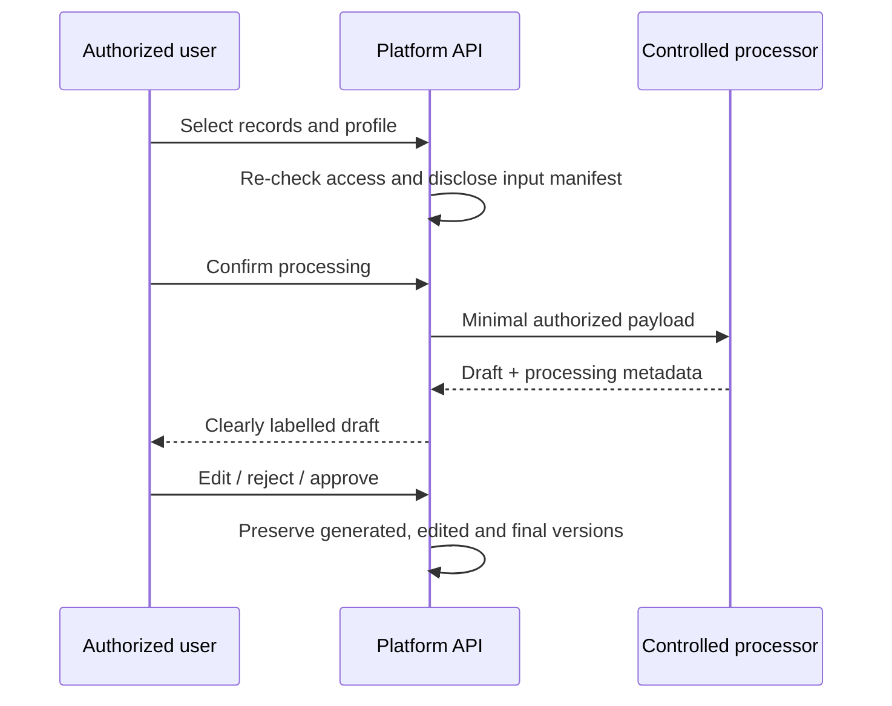

# SRS-10 AI-assisted processing and provenance

## 1. Purpose

Allow controlled assistance with extraction and drafting while keeping identity, evidence acceptance and official assessment under human authority.

## 2. Permitted capability boundary

| Capability | Phase | Authority |
|---|---|---|
| OCR of certificates/documents | P2 | Draft extraction only; human reviews |
| Audio transcription/speaker separation | P2 | Draft transcript; human confirms speakers |
| Classification/evidence tags | P2 | Suggestion only |
| Rubric/skill matching | P2 | Suggestion only; cannot set step |
| Summary/report draft | P2 | Human edits and publishes |
| Identity match or official step award | Excluded | Human decision only |

Final permitted AI uses remain Policy TBD H-10.

## 3. Functional requirements

| ID | Requirement | Status | Phase |
|---|---|---|---|
| AI-FR-001 | Before execution, the UI shall list the exact records and fields sent to the processor. | Confirmed POC direction | P0/P2 |
| AI-FR-002 | The user shall select only records they are authorized to read; the server shall re-check access before processing. | Recommended architecture | P2 |
| AI-FR-003 | Output shall record model/service, version, prompt template/version, parameters, input references, actor and timestamps. | Confirmed architecture | P2 |
| AI-FR-004 | The system shall preserve `generated_text`, `teacher_edited_text` and `final_published_text` separately. | Confirmed M-17 | P2 |
| AI-FR-005 | Three controlled profiles shall be offered: academic reasoning; non-academic/personal growth; interpersonal/intrapersonal development. | Confirmed M-16 | P2 |
| AI-FR-006 | Teachers may adjust allowed emphasis, age/class, tone, length and omissions; arbitrary privileged instructions are not passed through unchecked. | Confirmed M-16/recommended security | P2 |
| AI-FR-007 | AI outputs shall use a brown-toned visual treatment and a clear draft label until human approval. | Confirmed UI convention | P0/P2 |
| AI-FR-008 | AI failure shall not block manual assessment or portfolio publication. | Recommended architecture | P2 |
| AI-FR-009 | Sensitive data sent to external processors shall follow configured consent, residency, retention and vendor policy. | Policy TBD H-07/H-10 | P2 |

## 4. Input and output limits

| Field | Minimum | Maximum/status |
|---|---:|---|
| Prompt profile | 1 | Exactly one approved profile per job |
| Teacher instruction | 0 | 4,000 characters |
| Source items | 1 | 100 temporary cap |
| Generated draft | 0 | 20,000 characters |
| Human edit | 0 | 20,000 characters |
| Retry count | 0 | 3 temporary cap |

Large media is processed through background jobs, not inserted into browser-side prompts. The processor receives authorized storage references or derived text, not database credentials or SQL.

## 5. Provenance flow

## 6. Acceptance scenarios

- A teacher sees the complete input manifest before starting a job.
- Removing one source item changes the manifest and job provenance.
- An AI suggestion cannot call the assessment-publication action.
- Teacher edits do not overwrite generated text.
- Service failure leaves manual workflows available and shows a local action-level error.

