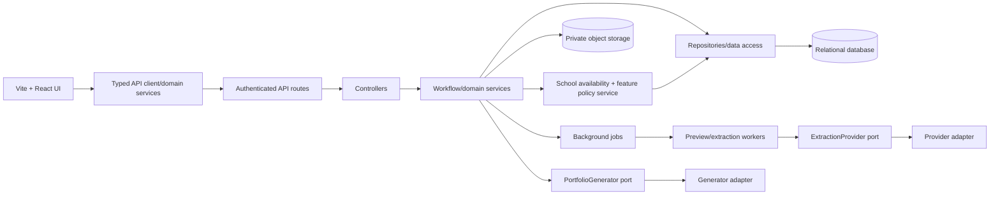

# SRS-11 Infrastructure, security and operations

## 1. Target structure

Browser code shall never contain SQL, database credentials, direct database connections or privileged filtering rules.

## 2. Functional and non-functional requirements

| ID | Requirement | Status | Phase |
|---|---|---|---|
| OPS-FR-001 | The frontend default shall be Vite + React with shared typed API services and reusable domain components. | Repository standard | P0 |
| OPS-FR-002 | Repeated visual rules shall use Tailwind and semantic classes composed with `@apply`; pages shall not duplicate large utility sets. | Repository standard | P0 |
| OPS-FR-003 | The server shall use `route → controller → service/use-case → repository → database` separation. | Repository standard | P0 |
| OPS-FR-004 | SQL shall exist only in repository/data-access modules and shall always use parameterized statements. | Repository standard | P0 |
| OPS-FR-005 | Protected APIs shall enforce authorization and validation server-side using shared enums and policy limits. | Recommended architecture | P0 |
| OPS-FR-006 | Files shall use private object storage; database records store metadata and non-public keys, not public permanent URLs. | Recommended architecture | P1 |
| OPS-FR-007 | Preview, scan, export, OCR and transcription work shall use idempotent background jobs where processing can exceed an interactive request. | Recommended architecture | P1/P2 |
| OPS-FR-008 | Production shall provide encrypted transport, secret management, backups, restore testing, monitoring and structured audit logs. | Recommended architecture | P1 |
| OPS-FR-009 | Retention/deletion jobs shall remain disabled until H-07 policy is confirmed; manual audited restriction/disable remains available. | Safe default | P1 |
| OPS-FR-010 | The system shall expose health/readiness checks without exposing secrets, user data or dependency credentials. | Recommended architecture | P1 |
| OPS-FR-011 | A kernel-owned school/feature policy service shall compute effective availability from school state, the feature registry and the school-specific policy before the use-case executes. | Approved System Analyst architecture decision, 27 Oct 2026 | P0/P1 |
| OPS-FR-012 | AI/extraction SDKs, credentials and provider payloads shall exist only in infrastructure adapters behind typed `ExtractionProvider` and `PortfolioGenerator` ports. | Approved System Analyst architecture decision, 27 Oct 2026 | P1 contract/P2 provider |
| OPS-FR-013 | Background workers shall re-check `school_id`, `schools.is_disabled`, feature availability, consent and input version when claiming a job and before committing its output. | Approved System Analyst architecture decision, 27 Oct 2026 | P1/P2 |
| OPS-FR-014 | A single-school local installation shall seed/configure one school and use the same school-scoped repositories and APIs as hosted mode; a code path that omits tenant scope is not permitted. | Approved System Analyst architecture decision, 27 Oct 2026 | P0 |
| OPS-FR-015 | A dedicated platform-operations controller/use-case shall expose audited school disable/re-enable and per-school feature-policy changes. The controller translates transport only; `SchoolFeaturePolicyService` computes and enforces the rule. | Approved System Analyst architecture decision, 27 Oct 2026 | P1 |
| OPS-FR-016 | The kernel shall maintain queryable dependency links from proof and identity associations to observations, assessment results, Portfolio claims, generation runs and snapshots so an authorized correction can produce an impact preview and mark every dependant `needs_review`/`stale`. | Approved System Analyst architecture decision, 27 Oct 2026 | P1 |
| OPS-FR-017 | A correction decision and its immediate dependency-state changes shall commit atomically, or through an idempotent transactional-outbox job when the cascade is asynchronous. A failed cascade shall be retryable and shall never publish a replacement result automatically. | Approved System Analyst architecture decision, 27 Oct 2026 | P1 |

## 3. API and component rules

- Pages compose focused components; components handle presentation and local interaction, not persistence.
- Domain hooks/services group fetching by resource and accept scope/filter parameters instead of duplicating role-specific fetch code.
- Routes define transport and middleware only. Controllers translate HTTP requests/responses. Services enforce workflow. Repositories own persistence and SQL.
- Controllers pass the authenticated `school_id` into use-cases; repositories require that scope or use a school-scoped parent relation. Browser-supplied school IDs are never trusted by themselves.
- Feature flags are availability controls, not authorization. The service must pass both the school/feature gate and the existing role/scope/lifecycle/consent checks.
- The kernel owns job state, validation, provenance, human-review state and snapshot publication. Adapters own provider translation only and cannot call repositories directly.
- API responses use documented DTOs and do not mirror database rows blindly.
- Shared validation schemas enforce the same enum, minimum and maximum in UI and server; the server remains authoritative.
- Errors use the SRS-00 envelope. Page-level failures may use a top overlay; input/file errors appear next to the initiating action.

## 4. Visual infrastructure

- White page background; no decorative grey-tinted page canvas.
- Restrained pastel orange accent with sufficient text contrast.
- Pink/red background marks unresolved requirements, not ordinary importance.
- Brown-toned background marks AI-generated/draft material.
- Prefer separators, spacing and max-height scrolling over repeated nested rounded containers.
- Cards are used only for genuinely grouped content; inner rows should not repeat the same radius and border.

## 5. Operational limits

| Control | Temporary requirement |
|---|---|
| JSON request body | Maximum 1 MiB; file endpoints use multipart policies |
| Interactive API timeout | 30 seconds; longer work becomes a job |
| Pagination | 20 default, 100 maximum |
| Synchronous export | 50,000 rows maximum |
| Audit retention | Policy TBD H-07; no automatic purge before approval |
| Backup | Daily encrypted backup; target retention and RPO/RTO are Policy TBD |
| Restore test | At least quarterly temporary operational baseline |

## 6. Security controls

- Password hashes use a current adaptive password hash; never store or log plaintext.
- Cookies use Secure, HttpOnly and SameSite settings in production; state-changing requests require CSRF/request protection.
- Validate upload content, rate-limit authentication and sensitive jobs, and redact secrets/personal data from application logs.
- Audit records are append-only to ordinary users and include actor, active role, scope, action, target, outcome and time.
- Apply dependency scanning, database migrations, environment-specific configuration and least-privilege service accounts.

## 7. Acceptance scenarios

- Searching the production frontend bundle finds no SQL or credentials.
- A page component uses a domain API service rather than importing a repository/database module.
- Direct API calls receive the same permission decision as the UI.
- A 200 MB video upload is rejected or queued under its configured 500 MB cap without blocking the web process.
- A backup can restore a snapshot and its linked media metadata in a documented test.
- A cross-school record ID is rejected even when the requesting role would be valid in its own school.
- Disabling a school or feature after queueing prevents a worker from committing a stale result.
- Provider adapters can be replaced by test doubles without changing a controller, repository schema or visualization response.
- Excluding a proof used by multiple observations produces a complete impact list and marks every dependant for review exactly once, including after a worker retry.
- A partial dependency-cascade failure leaves no silently published replacement; retry completes the same audited correction decision idempotently.

