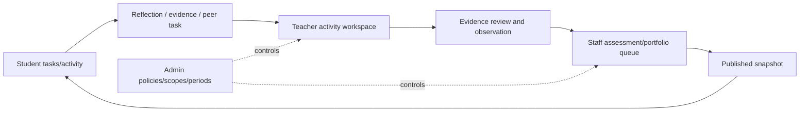

# SRS-12 Page catalogue and role visibility

## 1. Purpose

Define the visible product for each role and remove the POC assumption that every authenticated user should see Activities, Students, Questions, Media, Portfolio and AI.

## 2. Page catalogue

| Area/page | Student | Teacher | Staff | SchoolAdmin | Phase |
|---|---|---|---|---|---|
| Home and tasks | Own tasks/results | Assigned workload | Operations queues | School operations | P0/P1 |
| My activities / Activities | Enrolled, published/assigned | Assigned + create draft | Delegated catalogue/approval | School metadata/policy | P0/P1 |
| Activity workspace | Own activity detail and response | Roster, form, VASK, evidence, assessment | Review/exception scope | Policy/admin view | P1 |
| Students | Own profile only | Assigned students | Delegated students | Administrative directory | P0/P1 |
| Classes | No class directory | Assigned classes | Delegated classes | Manage all | P1 |
| Question/form library | Assigned questions only | Approved catalogue + own drafts | Review/publish delegated library | Configure authority | P1 |
| My media / Evidence | Own/permitted | Assigned/permitted | Moderation scope | Metadata; raw by grant | P0/P1 |
| External achievement | Create/view own | Review assigned student | Moderation | Policy/admin | P1 |
| Peer review | Named task only | Assign/monitor | Moderate | Policy only | P1 |
| Feedback and step confirmation | Published own result | Submit for assigned activity | Review/publish | Policy only | P1 |
| Proud Moments | When window open | Class review if assigned | Open/review window | Configure window | P0/P1 |
| My portfolio / Portfolio release | Own published snapshot | Assigned student review | Preview/publish/withdraw | Policy/export | P1 |
| Imports/data quality | No | Assigned activity imports | Resolve delegated queues | Configure/import all | P0/P1 |
| AI drafts | Published final text only | Authorized assigned drafts | Review delegated drafts | Configure policy | P2 |
| Decisions/TBD register | No | Read relevant prompts only | Maintain decisions | Maintain/approve policy | P0 |
| Users, roles, periods, audit | No | No | Delegated operations only | Full administration | P1 |

## 3. Role-specific navigation

### Student

Home; My activities; My media; External achievement; Peer-review tasks; Proud Moments when open; My portfolio; Privacy and corrections.

### Teacher

Dashboard; Activities; Activity workspace; Bulk assessment/import; Evidence review; Feedback and step confirmation; Peer assignment; Assigned students/classes.

### SuperTeacher/Staff

Operations dashboard; Activity catalogue/approval; Form library; Evidence moderation; Assessment review; Portfolio release; Imports/data quality; Reports/exports; Decision register.

### SchoolAdmin

Staff navigation plus Users/groups/periods; Roles/scopes; Consent/retention/upload policy; Source systems/import configuration; Audit/sessions/security.

## 4. UI requirements

| ID | Requirement | Status | Phase |
|---|---|---|---|
| UI-FR-001 | Navigation shall be generated from server-backed capabilities. | Recommended architecture | P0 |
| UI-FR-002 | Routes shall have capability guards, but the API remains authoritative. | Recommended architecture | P0 |
| UI-FR-003 | Each page shall define loading, empty, forbidden, validation, system-error and stale-state behaviour. | Recommended architecture | P0 |
| UI-FR-004 | Numeric inputs shall show their active range, for example `Whole number, 1–16`, and use matching HTML/API validation. | Confirmed SRS rule | P0 |
| UI-FR-005 | Unresolved rules shall use a pink/red background and show their decision ID. | Confirmed design convention | P0 |
| UI-FR-006 | AI-generated content shall use a brown-toned background and show source/provenance. | Confirmed design convention | P0/P2 |
| UI-FR-007 | Input/file errors shall appear beside the initiating control; system-wide failures may use a top overlay. | Confirmed design convention | P0 |
| UI-FR-008 | Tables/lists shall use line separators and bounded scrolling where needed instead of layers of matching rounded boxes. | Confirmed design convention | P0 |

## 5. Current POC gap map

| Current POC area | Assessment | Required correction |
|---|---|---|
| Generic menu for all roles | Conflicts | Replace with capability-driven role navigation |
| Activities/detail | Partial | Add lifecycle, approval, assignment scope and full activity workspace |
| Students/classes | Partial | Remove student directory access; enforce effective assignments |
| Questions | Partial/conflicts | Hide global bank from students; add form/version/mapping governance |
| Media library | Partial | Add consent grants, moderation, external-achievement separation and private originals |
| Portfolio curation | Partial | Add snapshot, class-teacher review, staff release and withdrawal |
| AI page | POC demonstration | Restrict to authorized P2 workflow; students see approved final text only |
| Decisions/admin | Partial | Add full policy, role/scope, source, audit and security administration |
| Missing pages | Missing | Tasks, external achievements, peer review, privacy/correction, bulk assessment, queues, exports |

## 6. Page transition overview

## 7. Acceptance scenarios

- A student has no Students, Classes, global Questions, Decisions, Admin or AI-draft navigation item.
- A class teacher and activity teacher see different records even if both use the Teacher interface.
- Returning a published record for modification immediately removes the current published state while preserving history.
- Every visible number field includes a displayed range or configured scale.
- Direct navigation to a hidden page is denied consistently by route guard and API.

