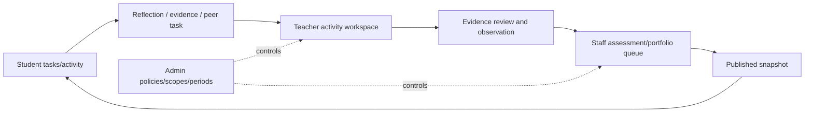

# SRS-12 Page catalogue and role visibility

## 1. Purpose

Define the visible product for each role and remove the POC assumption that every authenticated user should see Activities, Students, Questions, Media, Portfolio and AI.

## 2. Page catalogue

| Area/page | Student | Teacher | Staff | SchoolAdmin | Phase |
|---|---|---|---|---|---|
| Home and tasks | Own tasks/results | Assigned workload | Operations queues | School operations | P0/P1 |
| My activities / Activities | Enrolled, published/assigned | Capability-scoped view/create | Delegated catalogue/approval | School metadata/policy | P0/P1 |
| Activity workspace | Own activity detail and response | Roster, form, VASK, evidence, assessment | Review/exception scope | Policy/admin view | P1 |
| Students | Own profile only | Assigned students | Delegated students | Administrative directory | P0/P1 |
| Classes | No class directory | Assigned classes | Delegated classes | Manage all | P1 |
| Question/form library | Assigned questions only | Approved catalogue + own drafts | Review/publish delegated library | Configure authority | P1 |
| My media / Evidence | Own/permitted | Assigned/permitted | Moderation scope | Metadata; raw by grant | P0/P1 |
| External achievement | Create/view own | Review assigned student | Moderation | Policy/admin | P1 |
| Peer review | Named task only | Assign/monitor | Moderate | Policy only | P1 |
| Feedback and step confirmation | Published own result | Submit for assigned activity | Review/publish | Policy only | P1 |
| Rubric source comparison and correction impact | Published source summary only | Assigned observations/proof | Compare types; include/exclude; resolve affected results | Policy/audit; decide only if separately assigned | P1/P2 |
| Proud Moments | When window open | Class review if assigned | Open/review window | Configure window | P0/P1 |
| My portfolio / Portfolio release | Latest own draft plus approved official view | Assigned class-teacher review; all/subset selection | Approve/publish/withdraw by assignment | Policy/export | P1 |
| Imports/data quality | No | Assigned activity imports | Resolve delegated queues | Configure/import all | P0/P1 |
| AI drafts | Published final text only | Authorized assigned drafts | Review delegated drafts | Configure policy | P2 |
| Decisions/TBD register | No | Read relevant prompts only | Maintain decisions | Maintain/approve policy | P0 |
| Staff directory/search | No | Search only when capability/scoped task requires it | Delegated directory | Full school directory | P1 |
| Positions, roles, capabilities and scopes | No | Read own effective assignments | Delegated read | Configure with affected-user preview | P1 |
| Approval inbox/escalation | No | Named assignments | Delegated/default queue | Configure policy/queue; decide only if separately assigned | P1 |
| Users, groups, periods, audit | No | No | Delegated operations only | Full administration | P1 |
| School and feature availability | No | No | Read delegated status | View effective policy; change only if delegated | P1 |

## 3. Role-specific navigation

### Student

Home; My activities; My media; External achievement; Peer-review tasks; Proud Moments when open; My portfolio; Privacy and corrections.

### Teacher

Dashboard; Activities; Activity workspace; Bulk assessment/import; Evidence review; Feedback and step confirmation; Peer assignment; Assigned students/classes.

### SuperTeacher/Staff

Operations dashboard; Activity catalogue/approval; Form library; Evidence moderation; Assessment review; Portfolio release; Imports/data quality; Reports/exports; Decision register.

### SchoolAdmin

Staff navigation plus Users/positions/groups/periods; Roles/capabilities/scopes; Approval policies/default and escalation queues; Consent/retention/upload policy; Source systems/import configuration; effective school/feature availability; Audit/sessions/security.

## 4. UI requirements

| ID | Requirement | Status | Phase |
|---|---|---|---|
| UI-FR-001 | Navigation shall be generated from server-backed capabilities. | Recommended architecture | P0 |
| UI-FR-002 | Routes shall have capability guards, but the API remains authoritative. | Recommended architecture | P0 |
| UI-FR-003 | Each page shall define loading, empty, forbidden, validation, system-error and stale-state behaviour. | Recommended architecture | P0 |
| UI-FR-004 | Numeric inputs shall show their active range, for example `Whole number, 1–16`, and use matching HTML/API validation. | Confirmed SRS rule | P0 |
| UI-FR-005 | Unresolved rules shall use a pink/red background and show their decision ID. | Confirmed design convention | P0 |
| UI-FR-006 | AI-generated content shall use a brown-toned background and show source/provenance. | Confirmed design convention | P0/P2 |
| UI-FR-007 | Input/file errors shall appear beside the initiating control; system-wide failures may use a top overlay. | Confirmed design convention | P0 |
| UI-FR-008 | Tables/lists shall use line separators and bounded scrolling where needed instead of layers of matching rounded boxes. | Confirmed design convention | P0 |
| UI-FR-009 | When a server feature policy blocks a page or action, the UI shall hide or disable the entry as appropriate and handle `FEATURE_NOT_AVAILABLE` with a clear non-failure explanation; it shall not imply that hiding is the security control. | Approved System Analyst architecture decision, 27 Oct 2026 | P0/P1 |
| UI-FR-010 | The assessment review UI shall show the official selected result separately from each proof/input type's candidate maximum and included maximum, with the exact candidate/included observations, source links and decision states. | Approved System Analyst architecture decision, 27 Oct 2026 | P1 |
| UI-FR-011 | Authorized reviewers shall have item-level include, exclude, invalidate, supersede and restore-by-new-decision actions as applicable. Before committing a correction, the UI shall preview affected observations, claims, generation runs and published snapshots and require a reason. | Approved System Analyst architecture decision, 27 Oct 2026 | P1 |
| UI-FR-012 | Parallel LLM suggestions shall display provider, model, prompt version, frozen input manifest and human decision. The UI shall not preselect a suggestion as the official result or hide a conflicting suggestion by overwriting it. | Approved System Analyst architecture decision, 27 Oct 2026 | P2 |
| UI-FR-013 | The first release shall use one common Teacher workspace. Navigation and actions shall be capability-driven; job title shall be displayed for context only and shall not select a hard-coded interface. | Approved System Analyst architecture decision, 28 Oct 2026 | P0/P1 |
| UI-FR-014 | Staff/teacher search shall support combinable filters for name/identifier, active state, position, functional role, capability, department, subject, year, class, group, programme and approval eligibility, with pagination and server-side scope enforcement. | Approved System Analyst architecture decision, 28 Oct 2026 | P1 |
| UI-FR-015 | Activity detail shall show latest and current-approved revision distinctly, material-change approval state, owner/edit authority and a change-request action where direct editing is unavailable. | Approved System Analyst architecture decision, 28 Oct 2026 | P1 |
| UI-FR-016 | Portfolio review shall show the student's submitted version, class-teacher all/subset inclusion decision, latest approved fallback and `no_approved_version` status without presenting an unapproved draft as official. | Approved System Analyst architecture decision, 28 Oct 2026 | P1 |
| UI-FR-017 | Approval inboxes shall filter by workflow type, school scope, assignee, unassigned/declined/overdue state, due date and escalation status. Accept, return, approve, reject and reassign actions shall require the configured reason. | Approved System Analyst architecture decision, 28 Oct 2026 | P1 |
| UI-FR-018 | School-wide capability-policy changes shall provide a staged diff and affected-user preview before activation; an explicit deny and its source shall be visible to authorized administrators. | Approved System Analyst architecture decision, 28 Oct 2026 | P1 |

## 5. Current POC gap map

| Current POC area | Assessment | Required correction |
|---|---|---|
| Generic menu for all roles | Conflicts | Replace with capability-driven role navigation |
| Activities/detail | Partial | Add lifecycle, approval, assignment scope and full activity workspace |
| Students/classes | Partial | Remove student directory access; enforce effective assignments |
| Questions | Partial/conflicts | Hide global bank from students; add form/version/mapping governance |
| Media library | Partial | Add consent grants, moderation, external-achievement separation and private originals |
| Portfolio curation | Partial | Add working versions, all/subset class-teacher review, latest-approved fallback, staff release and withdrawal |
| AI page | POC demonstration | Restrict to authorized P2 workflow; students see approved final text only |
| Decisions/admin | Partial | Add position/role/capability/scope separation, approval policy, source, audit and security administration |
| Missing pages | Missing | Tasks, staff search/filter, approval/escalation inbox, external achievements, peer review, privacy/correction, bulk assessment and exports |

## 6. Page transition overview

## 7. Acceptance scenarios

- A student has no Students, Classes, global Questions, Decisions, Admin or AI-draft navigation item.
- A class teacher and activity teacher see different records even if both use the Teacher interface.
- Returning a published record for modification immediately removes the current published state while preserving history.
- Every visible number field includes a displayed range or configured scale.
- Direct navigation to a hidden page is denied consistently by route guard and API.
- A demo school sees only its server-enabled pilot/released features, and a copied URL cannot open a disabled feature.
- A reviewer can compare each source type's candidate and included maximums without mistaking either for the official level, and every displayed maximum opens the exact supporting sources.
- Excluding a used face match or proof first shows its downstream impact; after confirmation, affected published output is marked for withdrawal/reissue rather than silently recalculated.
- Two conflicting LLM suggestions remain visible as separate candidates with their own provenance and decisions.
- Filtering the staff directory to English-subject activity approvers returns only in-scope, currently eligible users and does not disclose out-of-scope staff.
- A teacher with a narrower deny sees the same Teacher layout but no forbidden activity row or action.
- When a student has a newer unapproved draft, official Portfolio preview clearly uses the prior approved version; if none exists it shows `no_approved_version` and queues the case.

