# Whole-schema comparison: Core, SRS and Playground v2

**Snapshot:** 10 November 2026. **Scope:** whole documented domain, split into four sections per version. Internal analysis, not a schema migration or acceptance report.

## How to read this file

- **Core:** fields and relationships extracted from the entity blocks of `Core data relationships.md`. Core also specifies entities and behavior in prose, especially §9.1; absence from an entity block does not mean absence from Core. Relationship arrows reflect the Core ER diagrams, not verified SQL foreign keys.
- **SRS:** conceptual data responsibilities and field concepts inferred from requirements, not literal SQL tables. The SRS does not define a complete physical schema; the diagrams are a reading aid and do not assert that a specific table or field name is mandated.
- **V2:** all 83 application tables and every column in the current `schema.js` create-from-zero schema, read through SQLite `PRAGMA table_info`. Solid arrows represent declared SQLite foreign keys only; the endpoint is the referenced table. A `_id` field without an arrow may be a logical reference without an enforced FK. Counts exclude SQLite internal tables. This is source-schema evidence, not proof the running database has that version, that a workflow works, or that authorization is correct.
- Four diagrams in each version improve readability. Cross-section relationships are listed after the V2 diagrams; entity IDs may also refer across sections. Class relationships show connectivity, not full cardinality. PK/FK, nullability and constraints must be checked in the source; no type implies approval of a policy.
- **Comparison labels:** `+V2` means present in V2 within the compared scope but no corresponding Core ER *entity block*; `−V2` means a Core ER entity has no same-name V2 table. These are name comparisons, not automatic defects: renames, merged tables and prose-defined entities are explained below. Unspecified does not mean forbidden or removed.

## Main findings

1. V2 is based on the Core but is not a literal implementation: `activity_instances` is `activities`; staff and participant records are combined into `activity_people`; V2 has separate later authoring and rubric tables. The Core itself includes later prose beyond its older ER blocks.
2. The SRS expresses required behavior and some fields, not a full alternative database schema. It cannot be used for a reliable table-by-table or column-by-column difference count.
3. In V2, `activity_revisions` physically has approval and publication states; `activities` has operational/disable fields. There is no literal `respondState` or `requestState` activity column. Individual submission states live in `assessment_submissions`; change requests and approval assignments have their own records.
4. An executable schema or FK does not prove that all domain rules are implemented. For example, absence of a declared FK is not by itself evidence of a runtime authorization defect. Inspect services and test workflows separately.

## Version 1 — Core entity diagrams

These diagrams reproduce the fields explicitly drawn in Core ER entity blocks; other required/proposed Core fields and entities may be specified elsewhere in prose.

### Core 1: Identity, school, permissions and approval

```mermaid
classDiagram
  class USERS {
    uuid user_id
    uuid school_id
    string external_user_id
    string display_name
    string email
    string status
    datetime created_at
    datetime updated_at
  }
  class STAFF_POSITION_DEFINITIONS {
    uuid position_id
    uuid school_id
    string position_code
    string name_en
    string name_zh
    string position_category
    int sort_order
    string status
    uuid created_by_user_id
    datetime created_at
  }
  class USER_POSITION_ASSIGNMENTS {
    uuid user_position_assignment_id
    uuid user_id
    uuid position_id
    uuid school_id
    uuid department_id
    uuid subject_id
    datetime effective_from
    datetime effective_until
    boolean is_primary
    string status
    uuid assigned_by_user_id
    datetime assigned_at
  }
  class ROLE_DEFINITIONS {
    uuid role_id
    string role_code
    string name_en
    string name_zh
    string role_category
    boolean assignable
    string description_en
    string description_zh
    string status
  }
  class USER_ROLE_ASSIGNMENTS {
    uuid user_role_assignment_id
    uuid user_id
    uuid role_id
    uuid school_id
    string scope_type
    uuid scope_id
    datetime effective_from
    datetime effective_until
    string status
    uuid assigned_by_user_id
    datetime assigned_at
    string ended_reason
  }
  class CAPABILITY_DEFINITIONS {
    uuid capability_id
    string capability_key
    string name_en
    string name_zh
    string resource_type
    boolean sensitive
    string status
  }
  class ROLE_CAPABILITIES {
    uuid role_capability_id
    uuid role_id
    uuid capability_id
    string effect
    string condition_key
    string status
    uuid configured_by_user_id
    datetime configured_at
  }
  class CAPABILITY_POLICY_OVERRIDES {
    uuid capability_policy_override_id
    uuid school_id
    string target_type
    uuid target_id
    uuid capability_id
    string effect
    string scope_type
    uuid scope_id
    datetime effective_from
    datetime effective_until
    string reason
    uuid configured_by_user_id
    datetime configured_at
    string status
  }
  class SCHOOLS {
    uuid school_id
    string school_code
    string name
    string operating_mode
    boolean is_disabled
    string disabled_reason
    uuid disabled_by_user_id
    datetime disabled_at
  }
  class FEATURE_DEFINITIONS {
    string feature_key
    string description
    string lifecycle
    string default_availability
  }
  class SCHOOL_FEATURE_POLICIES {
    uuid school_feature_policy_id
    uuid school_id
    string feature_key
    string availability
    string reason
    datetime starts_at
    datetime ends_at
    uuid configured_by_user_id
    datetime configured_at
  }
  class ACADEMIC_PERIODS {
    uuid period_id
    uuid school_id
    string name
    date starts_on
    date ends_on
  }
  class DEPARTMENTS {
    uuid department_id
    uuid school_id
    string department_code
    string name_en
    string name_zh
    uuid parent_department_id
    datetime effective_from
    datetime effective_until
    string status
    uuid created_by_user_id
    datetime created_at
  }
  class SUBJECTS {
    uuid subject_id
    uuid school_id
    string subject_code
    string name_en
    string name_zh
    datetime effective_from
    datetime effective_until
    string status
    uuid created_by_user_id
    datetime created_at
  }
  class DEPARTMENT_SUBJECTS {
    uuid department_subject_id
    uuid department_id
    uuid subject_id
    uuid school_id
    datetime effective_from
    datetime effective_until
    string status
    uuid assigned_by_user_id
    datetime assigned_at
  }
  class GROUPS {
    uuid group_id
    uuid school_id
    uuid period_id
    string group_type
    string name
  }
  class GROUP_MEMBERSHIPS {
    uuid group_membership_id
    uuid group_id
    uuid user_id
    string membership_role
    string class_number
    datetime starts_at
    datetime ends_at
  }
  class STAFF_GROUPS {
    uuid staff_group_id
    uuid school_id
    string group_code
    string name_en
    string name_zh
    string group_purpose
    uuid department_id
    uuid subject_id
    datetime effective_from
    datetime effective_until
    string status
    uuid created_by_user_id
    datetime created_at
  }
  class STAFF_GROUP_MEMBERSHIPS {
    uuid staff_group_membership_id
    uuid staff_group_id
    uuid user_id
    string membership_role
    datetime effective_from
    datetime effective_until
    string status
    uuid assigned_by_user_id
    datetime assigned_at
  }
  class APPROVAL_POLICY_VERSIONS {
    uuid approval_policy_version_id
    uuid school_id
    string workflow_type
    int policy_version
    string mode
    string scope_type
    uuid scope_id
    boolean allow_self_assignment
    boolean allow_self_approval
    boolean publication_separate
    int max_human_steps
    string default_queue_key
    int unassigned_escalation_minutes
    int overdue_escalation_minutes
    datetime effective_from
    datetime effective_until
    string status
    uuid configured_by_user_id
    datetime configured_at
  }
  class APPROVAL_POLICY_STEPS {
    uuid approval_policy_step_id
    uuid approval_policy_version_id
    int step_number
    string name_en
    string name_zh
    uuid required_capability_id
    string assignee_strategy
    int required_decision_count
    boolean reason_required
    string status
  }
  class APPROVAL_ASSIGNMENTS {
    uuid approval_assignment_id
    uuid school_id
    uuid approval_policy_version_id
    uuid approval_policy_step_id
    string target_type
    uuid target_id
    uuid target_version_id
    uuid assigned_by_user_id
    uuid assignee_user_id
    uuid assignee_role_assignment_id
    string status
    datetime assigned_at
    datetime accepted_at
    datetime due_at
    uuid delegated_from_assignment_id
    datetime delegation_effective_until
  }
  class APPROVAL_DECISIONS {
    uuid approval_decision_id
    uuid approval_assignment_id
    uuid school_id
    int step_number
    string outcome
    string reason
    uuid decided_by_user_id
    uuid used_capability_id
    string used_scope_type
    uuid used_scope_id
    datetime decided_at
  }
  class APPROVAL_ESCALATIONS {
    uuid approval_escalation_id
    uuid school_id
    uuid approval_assignment_id
    string target_type
    uuid target_id
    uuid target_period_id
    string trigger_reason
    string queue_key
    string status
    datetime triggered_at
    uuid owned_by_user_id
    datetime resolved_at
    string resolution_note
  }
  class VASK_ITEMS {
    uuid vask_item_id
    string category
    string name_zh
    string name_en
    int version_number
    string status
  }
  SCHOOLS --> USERS
  USERS --> USER_POSITION_ASSIGNMENTS
  STAFF_POSITION_DEFINITIONS --> USER_POSITION_ASSIGNMENTS
  USERS --> USER_ROLE_ASSIGNMENTS
  ROLE_DEFINITIONS --> USER_ROLE_ASSIGNMENTS
  SCHOOLS --> USER_ROLE_ASSIGNMENTS
  ROLE_DEFINITIONS --> ROLE_CAPABILITIES
  CAPABILITY_DEFINITIONS --> ROLE_CAPABILITIES
  SCHOOLS --> CAPABILITY_POLICY_OVERRIDES
  CAPABILITY_DEFINITIONS --> CAPABILITY_POLICY_OVERRIDES
  SCHOOLS --> SCHOOL_FEATURE_POLICIES
  FEATURE_DEFINITIONS --> SCHOOL_FEATURE_POLICIES
  USERS --> SCHOOL_FEATURE_POLICIES
  SCHOOLS --> DEPARTMENTS
  SCHOOLS --> SUBJECTS
  DEPARTMENTS --> DEPARTMENT_SUBJECTS
  SUBJECTS --> DEPARTMENT_SUBJECTS
  SCHOOLS --> GROUPS
  SCHOOLS --> ACADEMIC_PERIODS
  ACADEMIC_PERIODS --> GROUPS
  USERS --> GROUP_MEMBERSHIPS
  GROUPS --> GROUP_MEMBERSHIPS
  SCHOOLS --> STAFF_GROUPS
  DEPARTMENTS --> STAFF_GROUPS
  SUBJECTS --> STAFF_GROUPS
  USERS --> STAFF_GROUP_MEMBERSHIPS
  STAFF_GROUPS --> STAFF_GROUP_MEMBERSHIPS
  SCHOOLS --> APPROVAL_POLICY_VERSIONS
  APPROVAL_POLICY_VERSIONS --> APPROVAL_POLICY_STEPS
  CAPABILITY_DEFINITIONS --> APPROVAL_POLICY_STEPS
  APPROVAL_POLICY_STEPS --> APPROVAL_ASSIGNMENTS
  USERS --> APPROVAL_ASSIGNMENTS
  APPROVAL_ASSIGNMENTS --> APPROVAL_DECISIONS
  USERS --> APPROVAL_DECISIONS
  APPROVAL_ASSIGNMENTS --> APPROVAL_ESCALATIONS
```

### Core 2: Inputs, activities, forms and imports

```mermaid
classDiagram
  class ACTIVITY_TYPES {
    uuid activity_type_id
    string code
    string name
  }
  class ACTIVITY_TEMPLATES {
    uuid activity_template_id
    uuid activity_type_id
    string name_zh
    string name_en
    string description
    int version_number
    string status
    uuid created_by_user_id
  }
  class ACTIVITY_INSTANCES {
    uuid activity_id
    uuid school_id
    string external_activity_id
    uuid activity_template_id
    uuid group_id
    uuid created_by_user_id
    uuid latest_revision_id
    uuid current_approved_revision_id
    string operational_status
    uuid resolved_period_id
    string period_resolution_status
    datetime period_resolved_at
    uuid period_exception_approved_by
    string period_exception_reason
    datetime created_at
    datetime updated_at
  }
  class ACTIVITY_REVISIONS {
    uuid activity_revision_id
    uuid activity_id
    int revision_number
    string title_en
    string title_zh
    string description_en
    string description_zh
    string private_context
    string activity_type
    uuid subject_id
    uuid department_id
    datetime start_at
    datetime end_at
    uuid owner_user_id
    uuid requested_form_version_id
    boolean media_capture_expected
    string location
    datetime student_access_opens_at
    datetime student_access_closes_at
    datetime response_due_at
    string approval_status
    string publication_status
    string material_change_reason
    uuid supersedes_revision_id
    uuid created_by_user_id
    datetime created_at
    datetime submitted_at
    uuid approved_by_user_id
    datetime approved_at
  }
  class ACTIVITY_CHANGE_REQUESTS {
    uuid activity_change_request_id
    uuid school_id
    uuid activity_id
    uuid base_revision_id
    uuid requested_by_user_id
    uuid target_owner_user_id
    string field_key
    string current_value
    string proposed_value
    string reason
    string status
    uuid resolved_by_user_id
    string resolution_note
    uuid resulting_revision_id
    datetime requested_at
    datetime resolved_at
  }
  class ACTIVITY_PARTICIPANTS {
    uuid activity_participant_id
    uuid activity_id
    uuid user_id
    string participant_role
    string participation_status
    string attendance_status
  }
  class ACTIVITY_STAFF {
    uuid activity_staff_id
    uuid activity_id
    uuid user_id
    uuid role_assignment_id
    string relationship
    boolean can_edit
    datetime starts_at
    datetime ends_at
  }
  class ACTIVITY_TEMPLATE_VASK_ITEMS {
    uuid activity_template_vask_item_id
    uuid activity_template_id
    uuid vask_item_id
    string priority
  }
  class ACTIVITY_INSTANCE_VASK_ITEMS {
    uuid activity_instance_vask_item_id
    uuid activity_id
    uuid vask_item_id
    int vask_item_version_number
    string priority
    string source
    uuid configured_by_user_id
  }
  class ASSESSMENT_INSTRUMENTS {
    uuid assessment_instrument_id
    string name
    string description
    string instrument_type
    int version_number
    string status
    uuid created_by_user_id
    datetime created_at
    datetime updated_at
  }
  class INSTRUMENT_ITEMS {
    uuid instrument_item_id
    uuid assessment_instrument_id
    uuid question_id
    int display_order
    boolean is_required
    string section_name
    json configuration_json
  }
  class QUESTIONS {
    uuid question_id
    string question_code
    string question_text_zh
    string question_text_en
    string question_type
    uuid response_scale_id
    string ability_code
    string ability_name_zh
    string ability_name_en
    string ability_description_zh
    string ability_description_en
    boolean is_negatively_worded
    boolean requires_reverse_scoring
    string status
  }
  class QUESTIONNAIRE_CONSTRUCTS {
    uuid questionnaire_construct_id
    string code
    string name_zh
    string name_en
    string definition_zh
  }
  class RESPONSE_SCALES {
    uuid response_scale_id
    string code
    string name_zh
    int minimum_value
    int maximum_value
  }
  class RESPONSE_SCALE_OPTIONS {
    uuid response_scale_option_id
    uuid response_scale_id
    int numeric_value
    string label_zh
    int display_order
  }
  class INSTRUMENT_VERSIONS {
    uuid instrument_version_id
    uuid assessment_instrument_id
    int version_number
    uuid supersedes_version_id
    string review_status
    string publication_status
    string visibility_scope
    date valid_from
    date valid_until
    uuid created_by_user_id
    datetime created_at
  }
  class INSTRUMENT_REVIEW_EVENTS {
    uuid instrument_review_event_id
    uuid instrument_version_id
    string event_type
    uuid actor_user_id
    string decision_comment
    datetime event_at
  }
  class INSTRUMENT_REVIEW_ASSIGNMENTS {
    uuid instrument_review_assignment_id
    uuid instrument_version_id
    uuid assigned_by_user_id
    uuid reviewer_user_id
    string reviewer_role_required
    string assigned_scope
    datetime assigned_at
    datetime due_at
    string status
    datetime accepted_at
    datetime completed_at
    uuid completion_event_id
  }
  class ASSESSMENT_ASSIGNMENTS {
    uuid assessment_assignment_id
    uuid activity_id
    uuid instrument_version_id
    uuid assigned_by_user_id
    datetime assigned_at
    datetime opens_at
    datetime due_at
    string assignment_status
    string eligibility_check
  }
  class ASSIGNMENT_RECIPIENTS {
    uuid assignment_recipient_id
    uuid assessment_assignment_id
    uuid respondent_user_id
    uuid subject_user_id
    uuid reviewer_user_id
    string status
  }
  class ASSESSMENT_SUBMISSIONS {
    uuid assessment_submission_id
    uuid assignment_recipient_id
    string perspective
    string content_status
    string processing_status
    string visibility_status
    datetime submitted_at
    datetime created_at
    datetime updated_at
  }
  class QUESTION_RESPONSES {
    uuid question_response_id
    uuid assessment_submission_id
    uuid question_id
    decimal raw_numeric_value
    decimal scored_numeric_value
    string text_value
    uuid selected_option_id
    datetime created_at
    datetime updated_at
  }
  class SOURCE_SYSTEMS {
    uuid source_system_id
    uuid school_id
    string code
    string name
    string authority_scope
    string status
  }
  class IMPORT_BATCHES {
    uuid import_batch_id
    uuid school_id
    uuid source_system_id
    uuid uploaded_by_user_id
    string file_name
    string status
    datetime imported_at
  }
  class IMPORT_RECORDS {
    uuid import_record_id
    uuid import_batch_id
    string source_record_key
    string record_type
    string validation_status
    uuid resolved_entity_id
    json original_payload
  }
  class IMPORT_RECORD_CORRECTIONS {
    uuid import_record_correction_id
    uuid import_record_id
    string field_name
    string before_value
    string after_value
    string original_student_id
    string resolved_student_id
    string correction_reason
    uuid corrected_by_user_id
    datetime corrected_at
  }
  ACTIVITY_TYPES --> ACTIVITY_TEMPLATES
  ACTIVITY_TEMPLATES --> ACTIVITY_INSTANCES
  ACTIVITY_INSTANCES --> ACTIVITY_REVISIONS
  ACTIVITY_TYPES --> ACTIVITY_REVISIONS
  ACTIVITY_INSTANCES --> ACTIVITY_CHANGE_REQUESTS
  ACTIVITY_INSTANCES --> ACTIVITY_PARTICIPANTS
  ACTIVITY_INSTANCES --> ACTIVITY_STAFF
  ACTIVITY_TEMPLATES --> ACTIVITY_TEMPLATE_VASK_ITEMS
  ACTIVITY_INSTANCES --> ACTIVITY_INSTANCE_VASK_ITEMS
  ASSESSMENT_INSTRUMENTS --> INSTRUMENT_ITEMS
  QUESTIONS --> INSTRUMENT_ITEMS
  RESPONSE_SCALES --> RESPONSE_SCALE_OPTIONS
  RESPONSE_SCALES --> QUESTIONS
  QUESTIONNAIRE_CONSTRUCTS --> QUESTIONS
  QUESTIONS --> QUESTION_RESPONSES
  ASSESSMENT_INSTRUMENTS --> INSTRUMENT_VERSIONS
  INSTRUMENT_VERSIONS --> INSTRUMENT_REVIEW_ASSIGNMENTS
  INSTRUMENT_VERSIONS --> INSTRUMENT_REVIEW_EVENTS
  INSTRUMENT_VERSIONS --> INSTRUMENT_ITEMS
  INSTRUMENT_VERSIONS --> ASSESSMENT_ASSIGNMENTS
  ACTIVITY_INSTANCES --> ASSESSMENT_ASSIGNMENTS
  ASSESSMENT_ASSIGNMENTS --> ASSIGNMENT_RECIPIENTS
  ASSIGNMENT_RECIPIENTS --> ASSESSMENT_SUBMISSIONS
  ASSESSMENT_SUBMISSIONS --> QUESTION_RESPONSES
  RESPONSE_SCALE_OPTIONS --> QUESTION_RESPONSES
  SOURCE_SYSTEMS --> IMPORT_BATCHES
  IMPORT_BATCHES --> IMPORT_RECORDS
  IMPORT_RECORDS --> IMPORT_RECORD_CORRECTIONS
```

### Core 3: Processing, evidence, rubrics and AI

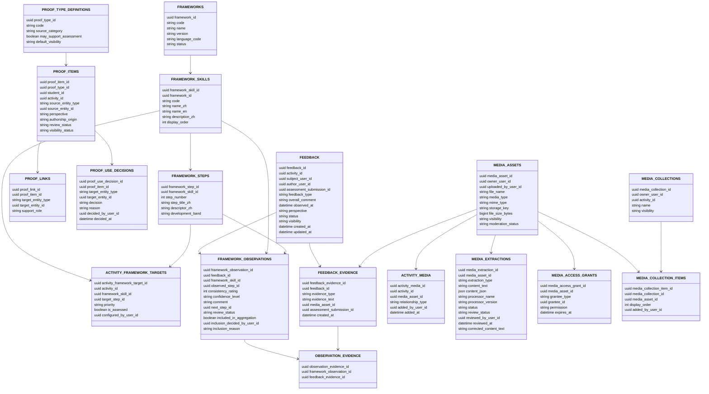

### Core 4: Portfolio and output

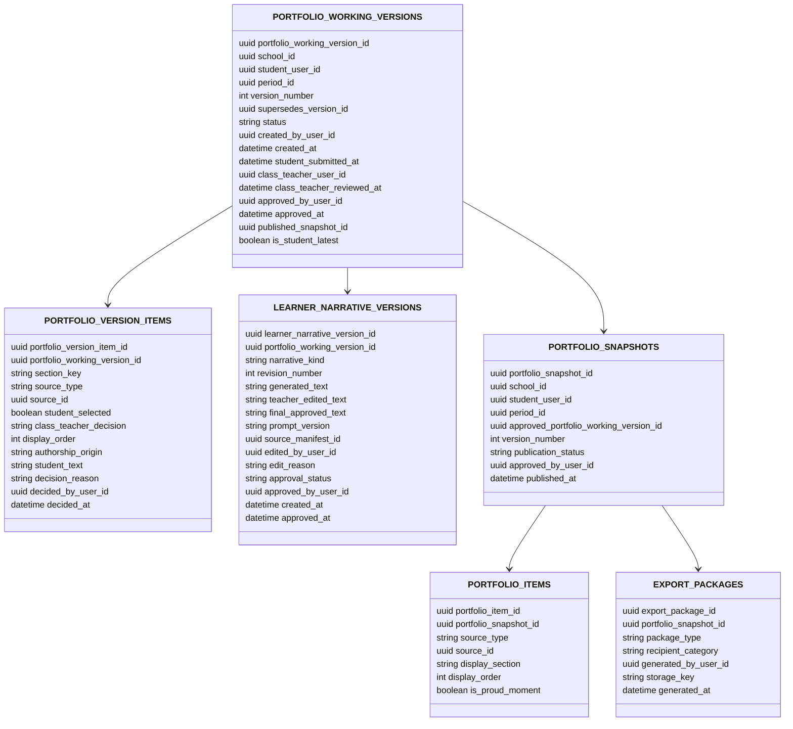

### Core relationships across sections

These connections are reproduced from the Core ER diagrams; the arrow shows diagram connectivity and is not a SQL foreign-key assertion.

`ACADEMIC_PERIODS` → `ACTIVITY_REVISIONS`; `ACADEMIC_PERIODS` → `PORTFOLIO_SNAPSHOTS`; `ACADEMIC_PERIODS` → `PORTFOLIO_WORKING_VERSIONS`; `ACTIVITY_INSTANCES` → `ACTIVITY_FRAMEWORK_TARGETS`; `ACTIVITY_INSTANCES` → `ACTIVITY_MEDIA`; `ACTIVITY_INSTANCES` → `FEEDBACK`; `ASSESSMENT_SUBMISSIONS` → `FEEDBACK`; `ASSESSMENT_SUBMISSIONS` → `FEEDBACK_EVIDENCE`; `GROUPS` → `ACTIVITY_INSTANCES`; `QUESTION_RESPONSES` → `PROOF_ITEMS`; `USERS` → `ACTIVITY_CHANGE_REQUESTS`; `USERS` → `ACTIVITY_INSTANCES`; `USERS` → `ACTIVITY_PARTICIPANTS`; `USERS` → `ACTIVITY_REVISIONS`; `USERS` → `ACTIVITY_STAFF`; `USERS` → `ASSESSMENT_ASSIGNMENTS`; `USERS` → `ASSIGNMENT_RECIPIENTS`; `USERS` → `EXPORT_PACKAGES`; `USERS` → `FEEDBACK`; `USERS` → `IMPORT_BATCHES`; `USERS` → `IMPORT_RECORD_CORRECTIONS`; `USERS` → `INSTRUMENT_REVIEW_ASSIGNMENTS`; `USERS` → `INSTRUMENT_REVIEW_EVENTS`; `USERS` → `MEDIA_ASSETS`; `USERS` → `PORTFOLIO_SNAPSHOTS`; `USERS` → `PORTFOLIO_WORKING_VERSIONS`; `VASK_ITEMS` → `ACTIVITY_INSTANCE_VASK_ITEMS`; `VASK_ITEMS` → `ACTIVITY_TEMPLATE_VASK_ITEMS`.

## Version 2 — SRS conceptual requirements

Names ending `_concept` are groupings for this comparison, not SRS table names or complete column specifications. Attributes are requirement concepts; consult the cited module for limits, conditionality, actors and uncertainty.

### SRS 1: Identity, school, permissions and approval

Source: SRS-01, SRS-02; SRS-04 ACT-FR-015–018.

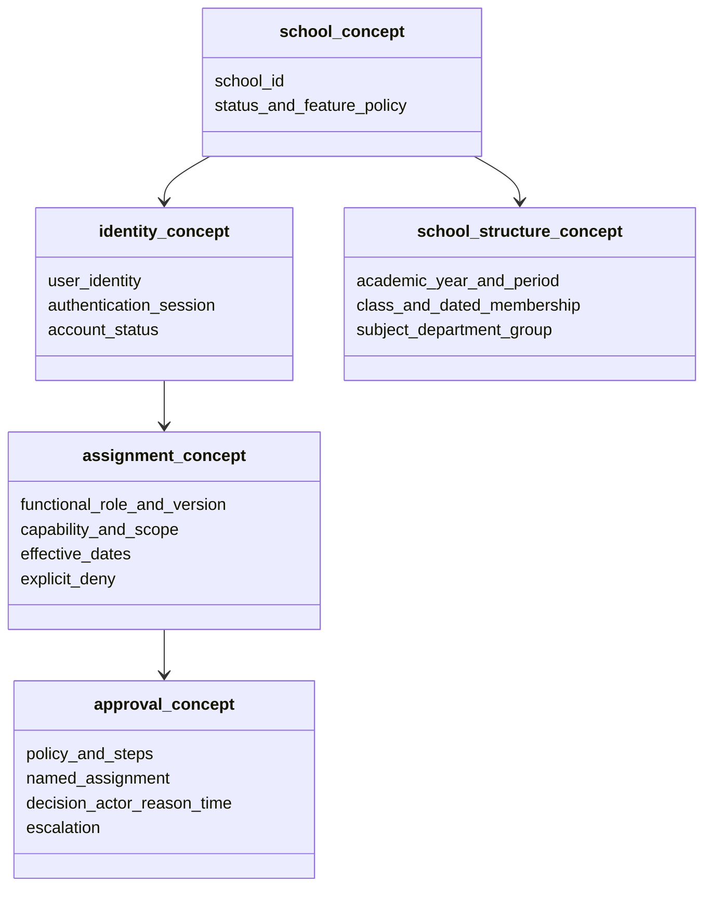

### SRS 2: Inputs, activities, forms and imports

Source: SRS-03–06, SRS-13.

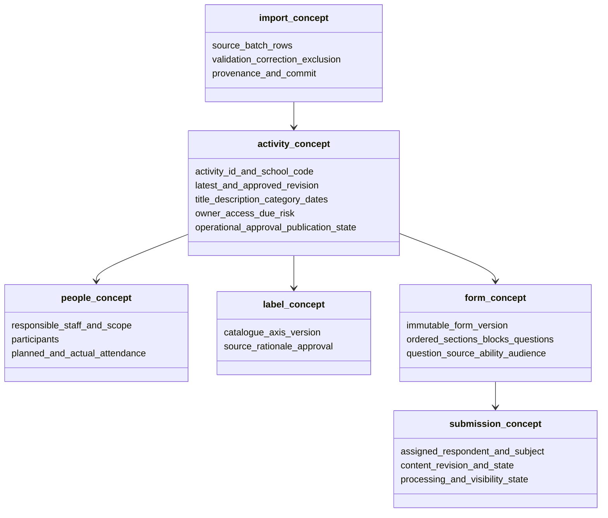

### SRS 3: Processing, evidence, rubrics and AI

Source: SRS-07–08, SRS-10–11, SRS-13.

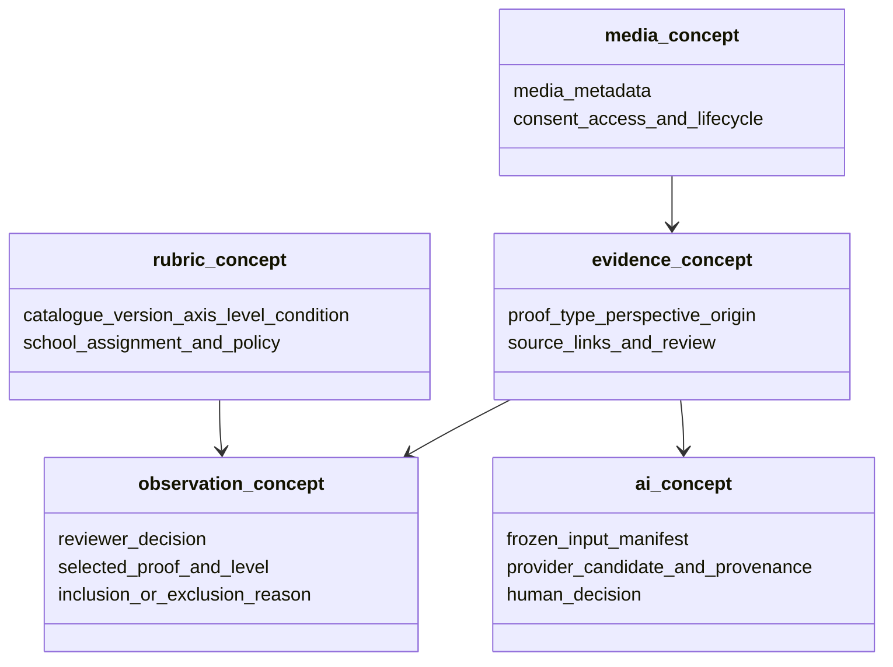

### SRS 4: Portfolio and output

Source: SRS-08–10, SRS-13.

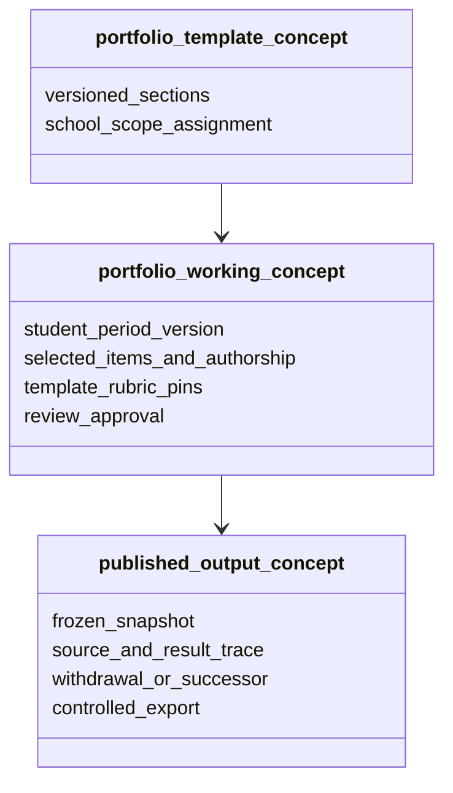

## Version 3 — actual V2 SQLite create schema

The following tables and columns come directly from `portfolio-poc-v2/server/repositories/schema.js`. Field types are SQLite declared types, with `UNKNOWN` if none; links within a section are declared foreign keys. The diagrams intentionally do not infer logical references.

### V2 1: Identity, school, permissions and approval

```mermaid
classDiagram
  class users {
    TEXT user_id
    TEXT school_id
    TEXT external_user_id
    TEXT user_type
    TEXT student_number
    TEXT staff_number
    TEXT name_en
    TEXT name_zh
    TEXT email
    TEXT status
    TEXT created_at
  }
  class schools {
    TEXT school_id
    TEXT name_en
    TEXT name_zh
    TEXT status
  }
  class staff_position_definitions {
    TEXT position_id
    TEXT school_id
    TEXT position_code
    TEXT name_en
    TEXT name_zh
    TEXT position_category
    INTEGER sort_order
    TEXT status
    TEXT created_by_user_id
    TEXT created_at
  }
  class user_position_assignments {
    TEXT user_position_assignment_id
    TEXT user_id
    TEXT position_id
    TEXT school_id
    TEXT department_id
    TEXT subject_id
    TEXT effective_from
    TEXT effective_until
    INTEGER is_primary
    TEXT status
    TEXT assigned_by_user_id
    TEXT assigned_at
  }
  class role_definitions {
    TEXT role_id
    TEXT role_code
    TEXT name_en
    TEXT name_zh
    TEXT role_category
    INTEGER assignable
    TEXT description_en
    TEXT description_zh
    TEXT status
  }
  class role_definition_versions {
    TEXT role_definition_version_id
    TEXT role_id
    INTEGER version_number
    TEXT lifecycle_status
    TEXT effective_from
    TEXT effective_until
    TEXT supersedes_role_definition_version_id
    TEXT created_by_user_id
    TEXT created_at
    TEXT activated_by_user_id
    TEXT activated_at
  }
  class user_role_assignments {
    TEXT user_role_assignment_id
    TEXT user_id
    TEXT role_id
    TEXT role_definition_version_id
    TEXT school_id
    TEXT scope_type
    TEXT scope_id
    TEXT effective_from
    TEXT effective_until
    TEXT status
    TEXT assigned_by_user_id
    TEXT assigned_at
    TEXT ended_reason
  }
  class capability_definitions {
    TEXT capability_id
    TEXT capability_key
    TEXT name_en
    TEXT name_zh
    TEXT resource_type
    INTEGER sensitive
    TEXT status
  }
  class role_capabilities {
    TEXT role_capability_id
    TEXT role_id
    TEXT capability_id
    TEXT effect
    TEXT condition_key
    TEXT status
    TEXT configured_by_user_id
    TEXT configured_at
  }
  class role_version_capabilities {
    TEXT role_version_capability_id
    TEXT role_definition_version_id
    TEXT capability_id
    TEXT effect
    TEXT condition_key
    TEXT status
    TEXT configured_by_user_id
    TEXT configured_at
  }
  class capability_policy_overrides {
    TEXT capability_policy_override_id
    TEXT school_id
    TEXT target_type
    TEXT target_id
    TEXT capability_id
    TEXT effect
    TEXT scope_type
    TEXT scope_id
    TEXT effective_from
    TEXT effective_until
    TEXT reason
    TEXT configured_by_user_id
    TEXT configured_at
    TEXT status
  }
  class staff_groups {
    TEXT staff_group_id
    TEXT school_id
    TEXT group_code
    TEXT name_en
    TEXT name_zh
    TEXT group_purpose
    TEXT department_id
    TEXT subject_id
    TEXT effective_from
    TEXT effective_until
    TEXT status
    TEXT created_by_user_id
    TEXT created_at
  }
  class staff_group_memberships {
    TEXT staff_group_membership_id
    TEXT staff_group_id
    TEXT user_id
    TEXT membership_role
    TEXT effective_from
    TEXT effective_until
    TEXT status
    TEXT assigned_by_user_id
    TEXT assigned_at
  }
  class departments {
    TEXT department_id
    TEXT school_id
    TEXT department_code
    TEXT name_en
    TEXT name_zh
    TEXT parent_department_id
    TEXT effective_from
    TEXT effective_until
    TEXT status
    TEXT created_by_user_id
    TEXT created_at
  }
  class subjects {
    TEXT subject_id
    TEXT school_id
    TEXT subject_code
    TEXT name_en
    TEXT name_zh
    TEXT effective_from
    TEXT effective_until
    TEXT status
    TEXT created_by_user_id
    TEXT created_at
  }
  class department_subjects {
    TEXT department_subject_id
    TEXT department_id
    TEXT subject_id
    TEXT school_id
    TEXT effective_from
    TEXT effective_until
    TEXT status
    TEXT assigned_by_user_id
    TEXT assigned_at
  }
  class student_class_memberships {
    TEXT student_class_membership_id
    TEXT student_user_id
    TEXT school_id
    TEXT class_id
    TEXT period_id
    TEXT effective_from
    TEXT effective_until
    TEXT status
  }
  class academic_periods {
    TEXT period_id
    TEXT school_id
    TEXT academic_year_id
    TEXT academic_year_label
    TEXT period_code
    TEXT name_en
    TEXT name_zh
    TEXT start_date
    TEXT end_date
    INTEGER sequence
    INTEGER is_summer
    TEXT portfolio_snapshot_due
    INTEGER resolution_priority
    TEXT status
  }
  class audit_events {
    INTEGER audit_event_id
    TEXT school_id
    TEXT actor_user_id
    TEXT action_code
    TEXT entity_type
    TEXT entity_id
    TEXT reason
    TEXT occurred_at
  }
  class approval_assignments {
    TEXT approval_assignment_id
    TEXT school_id
    TEXT approval_policy_version_id
    TEXT approval_policy_step_id
    TEXT target_type
    TEXT target_id
    TEXT target_version_id
    TEXT assignee_user_id
    TEXT assignee_role_assignment_id
    TEXT assigned_by_user_id
    TEXT status
    TEXT assigned_at
    TEXT accepted_at
    TEXT due_at
    TEXT delegated_from_assignment_id
    TEXT delegation_effective_until
  }
  class approval_decisions {
    TEXT approval_decision_id
    TEXT approval_assignment_id
    TEXT school_id
    INTEGER step_number
    TEXT outcome
    TEXT reason
    TEXT decided_by_user_id
    TEXT used_capability_id
    TEXT used_scope_type
    TEXT used_scope_id
    TEXT decided_at
  }
  class approval_escalations {
    TEXT approval_escalation_id
    TEXT school_id
    TEXT approval_assignment_id
    TEXT target_type
    TEXT target_id
    TEXT target_period_id
    TEXT trigger_reason
    TEXT queue_key
    TEXT status
    TEXT triggered_at
    TEXT owned_by_user_id
    TEXT resolved_at
    TEXT resolution_note
  }
  class approval_policy_steps {
    TEXT approval_policy_step_id
    TEXT approval_policy_version_id
    INTEGER step_number
    TEXT name_en
    TEXT name_zh
    TEXT required_capability_id
    TEXT assignee_strategy
    INTEGER required_decision_count
    INTEGER reason_required
    TEXT status
  }
  class approval_policy_versions {
    TEXT approval_policy_version_id
    TEXT school_id
    TEXT workflow_type
    INTEGER policy_version
    TEXT mode
    TEXT scope_type
    TEXT scope_id
    INTEGER allow_self_assignment
    INTEGER allow_self_approval
    INTEGER publication_separate
    INTEGER max_human_steps
    TEXT default_queue_key
    INTEGER unassigned_escalation_minutes
    INTEGER overdue_escalation_minutes
    TEXT status
    TEXT effective_from
    TEXT effective_until
    TEXT configured_by_user_id
    TEXT configured_at
  }
  users --> schools
  staff_position_definitions --> schools
  user_position_assignments --> staff_position_definitions
  user_position_assignments --> users
  role_definition_versions --> users
  role_definition_versions --> role_definition_versions
  role_definition_versions --> role_definitions
  user_role_assignments --> role_definition_versions
  user_role_assignments --> role_definitions
  user_role_assignments --> users
  role_capabilities --> capability_definitions
  role_capabilities --> role_definitions
  role_version_capabilities --> users
  role_version_capabilities --> capability_definitions
  role_version_capabilities --> role_definition_versions
  capability_policy_overrides --> capability_definitions
  staff_group_memberships --> users
  staff_group_memberships --> staff_groups
  departments --> schools
  subjects --> schools
  student_class_memberships --> users
  approval_assignments --> approval_policy_steps
  approval_assignments --> approval_policy_versions
  approval_decisions --> approval_assignments
  approval_policy_steps --> capability_definitions
  approval_policy_steps --> approval_policy_versions
```

### V2 2: Inputs, activities, forms and imports

```mermaid
classDiagram
  class activities {
    TEXT activity_id
    TEXT school_id
    TEXT external_activity_id
    TEXT activity_template_id
    TEXT group_id
    TEXT created_by_user_id
    TEXT latest_revision_id
    TEXT current_approved_revision_id
    TEXT operational_status
    TEXT resolved_period_id
    TEXT period_resolution_status
    TEXT period_resolved_at
    TEXT period_exception_approved_by
    TEXT period_exception_reason
    TEXT created_at
    TEXT updated_at
    TEXT disabled_previous_status
    TEXT disabled_reason
    TEXT disabled_by_user_id
    TEXT disabled_at
  }
  class activity_change_requests {
    TEXT activity_change_request_id
    TEXT school_id
    TEXT activity_id
    TEXT base_revision_id
    TEXT requested_by_user_id
    TEXT target_owner_user_id
    TEXT field_key
    TEXT current_value
    TEXT proposed_value
    TEXT reason
    TEXT status
    TEXT resolved_by_user_id
    TEXT resolution_note
    TEXT resulting_revision_id
    TEXT requested_at
    TEXT resolved_at
  }
  class activity_people {
    TEXT activity_person_id
    TEXT activity_id
    TEXT user_id
    TEXT person_type
    TEXT relationship_type
    TEXT role_assignment_id
    TEXT group_code
    TEXT planned_attendance_status
    TEXT actual_attendance_status
    TEXT attendance_approval_status
    INTEGER can_edit
    INTEGER can_view_raw_media
    INTEGER can_submit_response
    TEXT effective_from
    TEXT effective_until
    TEXT assigned_by_user_id
    TEXT assigned_at
    TEXT status
    TEXT supersedes_activity_person_id
    TEXT disabled_reason
    TEXT disabled_by_user_id
    TEXT disabled_at
    TEXT updated_by_user_id
    TEXT updated_at
  }
  class activity_revision_risk_flags {
    TEXT activity_revision_id
    TEXT flag_code
  }
  class activity_revisions {
    TEXT activity_revision_id
    TEXT activity_id
    INTEGER revision_number
    TEXT title_en
    TEXT title_zh
    TEXT description_en
    TEXT description_zh
    TEXT activity_type
    TEXT subject_id
    TEXT department_id
    TEXT start_at
    TEXT end_at
    TEXT owner_user_id
    TEXT requested_form_version_id
    INTEGER media_capture_expected
    TEXT location
    TEXT approval_status
    TEXT publication_status
    TEXT material_change_reason
    TEXT supersedes_revision_id
    TEXT created_by_user_id
    TEXT created_at
    TEXT submitted_at
    TEXT approved_by_user_id
    TEXT approved_at
    TEXT requested_publisher_user_id
  }
  class activity_label_assignments {
    TEXT activity_label_assignment_id
    TEXT activity_id
    TEXT activity_revision_id
    TEXT rubric_catalogue_id
    TEXT axis_id
    TEXT catalogue_version
    TEXT label_role
    TEXT source
    TEXT rationale
    TEXT approval_state
    TEXT assigned_by_user_id
    TEXT assigned_at
    TEXT status
    TEXT disabled_reason
    TEXT disabled_by_user_id
    TEXT disabled_at
  }
  class assessment_assignments {
    TEXT activity_form_assignment_id
    TEXT activity_id
    TEXT form_version_id
    TEXT assigned_by_user_id
    TEXT assigned_at
    TEXT opens_at
    TEXT due_at
    TEXT assignment_status
    TEXT eligibility_check
    TEXT notes
  }
  class assignment_recipients {
    TEXT assignment_recipient_id
    TEXT assessment_assignment_id
    TEXT respondent_user_id
    TEXT subject_user_id
    TEXT reviewer_user_id
    TEXT perspective
    TEXT status
    TEXT created_at
    TEXT assigned_by_user_id
    TEXT assigner_role_assignment_id
    TEXT due_at
    INTEGER moderation_required
    TEXT notes
  }
  class assessment_submissions {
    TEXT assessment_submission_id
    TEXT assignment_recipient_id
    INTEGER revision_number
    TEXT supersedes_submission_id
    TEXT perspective
    TEXT content_status
    TEXT processing_status
    TEXT visibility_status
    TEXT submitted_at
    TEXT reviewed_by_user_id
    TEXT reviewed_at
    TEXT review_reason
    TEXT created_at
    TEXT updated_at
  }
  class question_responses {
    TEXT question_response_id
    TEXT assessment_submission_id
    TEXT item_key
    TEXT prompt_en
    TEXT prompt_zh
    TEXT text_value
    REAL raw_numeric_value
    TEXT authorship_origin
    TEXT created_at
    TEXT updated_at
  }
  class form_versions {
    TEXT form_template_id
    TEXT form_version_id
    TEXT name_en
    TEXT name_zh
    TEXT version_number
    TEXT supersedes_form_version_id
    TEXT review_status
    TEXT publication_status
    TEXT visibility_scope
    INTEGER is_system_default
    TEXT respondent_roles
    TEXT valid_from
    TEXT valid_until
    TEXT submitted_for_review_at
    TEXT approved_by_user_id
    TEXT approved_at
    TEXT published_by_user_id
    TEXT published_at
    TEXT retired_at
    TEXT notes
  }
  class form_version_blocks {
    TEXT form_version_id
    TEXT question_block_version_id
    INTEGER display_order
  }
  class question_bank_versions {
    TEXT question_bank_version_id
    TEXT school_id
    TEXT definition_source_id
    TEXT bank_code
    TEXT name_en
    TEXT name_zh
    INTEGER version_number
    TEXT status
    TEXT created_by_user_id
    TEXT created_at
    TEXT activated_by_user_id
    TEXT activated_at
    TEXT disabled_reason
    TEXT disabled_by_user_id
    TEXT disabled_at
  }
  class question_blocks {
    TEXT question_block_id
    TEXT school_id
    TEXT block_code
    TEXT name_en
    TEXT name_zh
    TEXT latest_version_id
    TEXT current_published_version_id
    TEXT operational_status
    TEXT created_by_user_id
    TEXT created_at
    TEXT updated_by_user_id
    TEXT updated_at
    TEXT disabled_reason
    TEXT disabled_by_user_id
    TEXT disabled_at
  }
  class question_block_versions {
    TEXT question_block_version_id
    TEXT question_block_id
    INTEGER version_number
    TEXT name_en
    TEXT name_zh
    TEXT respondent_role_code
    TEXT ability_code
    TEXT ability_name_en
    TEXT ability_name_zh
    TEXT review_status
    TEXT publication_status
    TEXT supersedes_question_block_version_id
    TEXT created_by_user_id
    TEXT created_at
    TEXT submitted_at
    TEXT approved_by_user_id
    TEXT approved_at
    TEXT published_by_user_id
    TEXT published_at
  }
  class question_block_items {
    TEXT question_block_item_id
    TEXT question_block_version_id
    INTEGER display_order
    TEXT item_key
    TEXT source_question_block_item_id
    TEXT question_id
    TEXT question_version_id
    INTEGER required
    TEXT item_type
    TEXT prompt_en
    TEXT prompt_zh
    TEXT respondent_role_code
    TEXT answer_scale
    TEXT ability_code
    TEXT ability_name_en
    TEXT ability_name_zh
    TEXT proof_intent
  }
  class question_definitions {
    TEXT question_id
    TEXT school_id
    TEXT stable_code
    TEXT created_by_user_id
    TEXT created_at
    TEXT operational_status
  }
  class question_versions {
    TEXT question_version_id
    TEXT question_id
    TEXT question_bank_version_id
    INTEGER version_number
    TEXT source_sheet
    INTEGER source_row
    TEXT source_construct_en
    TEXT source_construct_zh
    TEXT subdomain
    TEXT prompt_en
    TEXT prompt_zh
    TEXT response_type
    TEXT scale_type
    TEXT scale_options_json
    INTEGER is_negative
    TEXT ability_code
    TEXT ability_name_en
    TEXT ability_name_zh
    TEXT ability_description_en
    TEXT ability_description_zh
    TEXT approval_status
    TEXT status
    TEXT supersedes_question_version_id
    TEXT created_by_user_id
    TEXT created_at
    TEXT disabled_reason
    TEXT disabled_by_user_id
    TEXT disabled_at
  }
  class source_systems {
    TEXT source_system_id
    TEXT school_id
    TEXT source_code
    TEXT name_en
    TEXT name_zh
    TEXT source_purpose
    TEXT connector_type
    TEXT endpoint_env_key
    TEXT authentication_profile_ref
    TEXT resolution_mode
    TEXT allowed_reference_pattern
    INTEGER returns_metadata
    INTEGER returns_short_lived_url
    INTEGER returns_streamed_bytes
    TEXT notes
    TEXT status
    TEXT import_status
    TEXT media_status
    TEXT disabled_reason
    TEXT disabled_by_user_id
    TEXT disabled_at
    TEXT created_by_user_id
    TEXT created_at
    TEXT updated_by_user_id
    TEXT updated_at
  }
  class import_batches {
    TEXT import_batch_id
    TEXT external_batch_key
    TEXT school_id
    TEXT source_system_id
    TEXT import_contract_version_id
    TEXT target_entity_type
    TEXT target_entity_id
    TEXT source_parent_key
    TEXT ingress_channel
    TEXT source_relative_path
    TEXT original_file_name
    TEXT content_type
    TEXT content_sha256
    TEXT source_uploaded_at
    TEXT uploaded_by_user_id
    TEXT requested_by_user_id
    TEXT service_actor_id
    TEXT received_at
    TEXT parsed_at
    TEXT validated_at
    TEXT committed_at
    TEXT committed_by_user_id
    TEXT seeded_at
    TEXT processing_status
    TEXT declared_processing_status
    TEXT parser_name
    TEXT parser_version
    INTEGER total_rows
    INTEGER valid_rows
    INTEGER warning_rows
    INTEGER error_rows
    INTEGER excluded_rows
    INTEGER committed_rows
    TEXT supersedes_import_batch_id
    TEXT disabled_reason
    TEXT disabled_by_user_id
    TEXT disabled_at
    TEXT updated_by_user_id
    TEXT updated_at
  }
  class import_batch_events {
    TEXT import_batch_event_id
    TEXT import_batch_id
    TEXT from_status
    TEXT to_status
    TEXT event_code
    TEXT actor_user_id
    TEXT reason
    TEXT details_json
    TEXT occurred_at
  }
  class import_contract_versions {
    TEXT import_contract_version_id
    TEXT contract_code
    TEXT version_number
    TEXT target_entity_type
    TEXT accepted_formats_json
    TEXT status
    TEXT created_by_user_id
    TEXT created_at
    TEXT disabled_reason
    TEXT disabled_by_user_id
    TEXT disabled_at
  }
  class import_record_corrections {
    TEXT import_record_correction_id
    TEXT import_record_id
    TEXT field_name
    TEXT before_value
    TEXT after_value
    TEXT original_student_id
    TEXT resolved_student_id
    TEXT correction_reason
    TEXT corrected_by_user_id
    TEXT corrected_at
  }
  class import_record_decisions {
    TEXT import_record_decision_id
    TEXT import_record_id
    TEXT decision
    TEXT reason
    TEXT decided_by_user_id
    TEXT decided_at
  }
  class import_record_links {
    TEXT import_record_link_id
    TEXT import_record_id
    TEXT entity_type
    TEXT entity_id
    TEXT entity_version_id
    TEXT commit_action
    TEXT reconciliation_status
    TEXT committed_by_user_id
    TEXT committed_at
    TEXT notes
  }
  class import_records {
    TEXT import_record_id
    TEXT import_batch_id
    INTEGER row_number
    TEXT source_record_key
    TEXT original_payload_json
    TEXT normalized_payload_json
    TEXT payload_sha256
    TEXT identity_status
    TEXT validation_status
    TEXT validation_errors_json
    TEXT validation_warnings_json
    TEXT resolved_user_id
    TEXT current_decision
    TEXT current_status
    TEXT supersedes_import_record_id
    TEXT created_at
    TEXT updated_at
  }
  class activity_source_bindings {
    TEXT activity_source_binding_id
    TEXT school_id
    TEXT activity_id
    TEXT source_system_id
    TEXT base_reference
    TEXT validation_mode
    TEXT status
    TEXT disabled_reason
    TEXT disabled_by_user_id
    TEXT disabled_at
    TEXT created_by_user_id
    TEXT created_at
    TEXT updated_by_user_id
    TEXT updated_at
  }
  class definition_sources {
    TEXT definition_source_id
    TEXT school_id
    TEXT source_kind
    TEXT source_code
    TEXT name_en
    TEXT name_zh
    TEXT version
    TEXT source_reference
    TEXT content_sha256
    TEXT status
    TEXT uploaded_by_user_id
    TEXT uploaded_at
    TEXT disabled_reason
    TEXT disabled_by_user_id
    TEXT disabled_at
  }
  activity_people --> activities
  activity_revision_risk_flags --> activity_revisions
  activity_revisions --> activities
  activity_label_assignments --> activity_revisions
  activity_label_assignments --> activities
  assessment_assignments --> form_versions
  assessment_assignments --> activities
  assignment_recipients --> assessment_assignments
  assessment_submissions --> assignment_recipients
  question_responses --> assessment_submissions
  form_version_blocks --> question_block_versions
  form_version_blocks --> form_versions
  question_bank_versions --> definition_sources
  question_block_versions --> question_blocks
  question_block_items --> question_versions
  question_block_items --> question_definitions
  question_block_items --> question_block_items
  question_block_items --> question_block_versions
  question_versions --> question_bank_versions
  question_versions --> question_definitions
  import_batches --> import_contract_versions
  import_batches --> source_systems
  import_batch_events --> import_batches
  import_record_corrections --> import_records
  import_record_decisions --> import_records
  import_record_links --> import_records
  import_records --> import_batches
  activity_source_bindings --> source_systems
  activity_source_bindings --> activities
```

### V2 3: Processing, evidence, rubrics and AI

```mermaid
classDiagram
  class activity_dependency_impacts {
    TEXT activity_dependency_impact_id
    TEXT activity_id
    TEXT dependency_type
    TEXT dependency_id
    TEXT impact_status
    TEXT reason
    TEXT triggered_by_user_id
    TEXT triggered_at
    TEXT resolved_by_user_id
    TEXT resolved_at
    TEXT resolution_note
  }
  class activity_media {
    TEXT activity_media_id
    TEXT activity_id
    TEXT media_asset_id
    TEXT relationship_type
    TEXT added_by_user_id
    TEXT added_at
    TEXT status
  }
  class media_assets {
    TEXT media_asset_id
    TEXT school_id
    TEXT owner_user_id
    TEXT uploaded_by_user_id
    TEXT uploaded_at
    TEXT title
    TEXT original_file_name
    TEXT media_type
    TEXT mime_type
    TEXT source_system_id
    TEXT external_media_reference_id
    TEXT storage_reference
    TEXT checksum_sha256
    TEXT consent_status
    TEXT visibility
    TEXT moderation_status
    TEXT processing_status
    TEXT captured_at
    TEXT retention_review_date
    TEXT operational_status
    TEXT created_at
    TEXT updated_by_user_id
    TEXT updated_at
    TEXT disabled_reason
    TEXT disabled_by_user_id
    TEXT disabled_at
  }
  class media_extractions {
    TEXT media_extraction_id
    TEXT media_asset_id
    TEXT extraction_type
    TEXT provider_key
    TEXT provider_version
    TEXT processing_status
    TEXT requested_by_user_id
    TEXT requested_at
    TEXT started_at
    TEXT processed_finished_at
    TEXT content_text
    TEXT content_json
    REAL confidence
    TEXT review_status
    TEXT reviewed_by_user_id
    TEXT reviewed_at
    TEXT review_reason
    TEXT corrected_content_text
    TEXT supersedes_media_extraction_id
    TEXT disabled_reason
    TEXT disabled_by_user_id
    TEXT disabled_at
  }
  class external_media_references {
    TEXT external_media_reference_id
    TEXT source_system_id
    TEXT opaque_reference
    TEXT student_id
    TEXT activity_id
    TEXT proof_item_id
    TEXT content_type_hint
    TEXT captured_at
    TEXT consent_status
    TEXT last_resolution_status
    TEXT last_resolved_at
    TEXT availability_status
    TEXT notes
  }
  class feedback {
    TEXT feedback_id
    TEXT activity_id
    TEXT subject_user_id
    TEXT author_user_id
    TEXT assessment_submission_id
    TEXT feedback_type
    TEXT overall_comment
    TEXT observed_at
    TEXT perspective
    TEXT status
    TEXT visibility
    TEXT created_at
    TEXT updated_at
  }
  class framework_observations {
    TEXT framework_observation_id
    TEXT feedback_id
    TEXT axis_id
    INTEGER observed_step
    INTEGER consistency_rating
    TEXT comment
    INTEGER suggested_next_step
    TEXT review_status
    INTEGER human_confirmed
    INTEGER included_in_aggregation
    TEXT inclusion_decided_by_user_id
    TEXT inclusion_reason
    TEXT created_at
  }
  class proof_items {
    TEXT proof_item_id
    TEXT proof_type_id
    TEXT student_id
    TEXT activity_id
    TEXT source_entity_type
    TEXT source_entity_id
    TEXT perspective
    TEXT summary
    TEXT occurred_at
    TEXT submitted_by_user_id
    TEXT provenance_status
    TEXT review_status
    TEXT visibility_status
    TEXT created_at
    TEXT disabled_at
  }
  class proof_links {
    TEXT proof_link_id
    TEXT proof_item_id
    TEXT target_entity_type
    TEXT target_entity_id
    TEXT support_role
    TEXT linked_by_user_id
    TEXT linked_at
    TEXT status
    TEXT notes
  }
  class rubric_axes {
    TEXT axis_id
    TEXT rubric_catalogue_id
    TEXT axis_code
    TEXT name_en
    TEXT name_zh
    TEXT axis_kind
    INTEGER display_order
    TEXT status
    TEXT notes
    TEXT rubric_group_id
  }
  class rubric_catalogues {
    TEXT rubric_catalogue_id
    TEXT code
    TEXT name_en
    TEXT name_zh
    TEXT version
    INTEGER labelling_capable
    INTEGER assessment_capable
    INTEGER radar_eligible
    TEXT level_order_type
    TEXT definition_completeness
    TEXT source_reference
    TEXT status
    TEXT notes
    TEXT selection_mode
    REAL score_out_of
    TEXT supersedes_rubric_catalogue_id
    TEXT activated_by_user_id
    TEXT activated_at
    TEXT disabled_reason
    TEXT disabled_by_user_id
    TEXT disabled_at
    TEXT definition_source_id
  }
  class rubric_groups {
    TEXT rubric_group_id
    TEXT rubric_catalogue_id
    TEXT group_code
    TEXT name_en
    TEXT name_zh
    INTEGER display_order
    TEXT status
    INTEGER disabled
  }
  class rubric_levels {
    TEXT level_id
    TEXT rubric_catalogue_id
    TEXT level_code
    INTEGER level_order
    INTEGER numeric_value
    TEXT name_en
    TEXT name_zh
    INTEGER is_prerequisite_chain
    TEXT status
  }
  class rubric_step_definitions {
    TEXT step_definition_id
    TEXT rubric_catalogue_id
    TEXT rubric_group_id
    TEXT axis_id
    TEXT level_id
    INTEGER step_number
    TEXT step_name_en
    TEXT step_name_zh
    TEXT definition_en
    TEXT definition_zh
    REAL score_min
    REAL score_max
    REAL score_out_of
    TEXT source_reference
    TEXT status
    INTEGER disabled
  }
  class school_rubric_assignments {
    TEXT school_rubric_assignment_id
    TEXT school_id
    TEXT purpose
    TEXT rubric_catalogue_id
    TEXT scope_type
    TEXT scope_id
    TEXT effective_from
    TEXT effective_until
    TEXT status
    TEXT assigned_by_user_id
    TEXT assigned_at
    TEXT reason
  }
  class ai_candidate_decisions {
    TEXT decision_id
    TEXT candidate_id
    TEXT outcome
    TEXT reason
    TEXT decided_by_user_id
    TEXT decided_at
  }
  class ai_draft_candidates {
    TEXT candidate_id
    TEXT manifest_id
    TEXT provider
    TEXT model
    TEXT prompt_version
    TEXT generated_text_en
    TEXT generated_text_zh
    TEXT source_refs_json
    TEXT review_status
    TEXT created_by_user_id
    TEXT created_at
  }
  class ai_input_manifests {
    TEXT manifest_id
    TEXT school_id
    TEXT student_user_id
    TEXT period_from
    TEXT period_to
    TEXT controlled_profile
    TEXT prompt_version
    TEXT status
    TEXT created_by_user_id
    TEXT created_at
  }
  class ai_manifest_sources {
    TEXT manifest_source_id
    TEXT manifest_id
    TEXT source_type
    TEXT source_id
    TEXT summary_en
    TEXT summary_zh
    INTEGER display_order
  }
  class entity_lifecycle_events {
    TEXT entity_lifecycle_event_id
    TEXT school_id
    TEXT entity_type
    TEXT entity_id
    TEXT action
    TEXT from_status
    TEXT to_status
    TEXT reason
    TEXT actor_user_id
    TEXT source_entity_type
    TEXT source_entity_id
    TEXT occurred_at
  }
  activity_media --> media_assets
  media_assets --> external_media_references
  media_extractions --> media_assets
  framework_observations --> rubric_axes
  framework_observations --> feedback
  proof_links --> proof_items
  rubric_axes --> rubric_catalogues
  rubric_groups --> rubric_catalogues
  rubric_levels --> rubric_catalogues
  rubric_step_definitions --> rubric_levels
  rubric_step_definitions --> rubric_axes
  rubric_step_definitions --> rubric_groups
  rubric_step_definitions --> rubric_catalogues
  school_rubric_assignments --> rubric_catalogues
  ai_candidate_decisions --> ai_draft_candidates
  ai_draft_candidates --> ai_input_manifests
  ai_manifest_sources --> ai_input_manifests
```

### V2 4: Portfolio and output

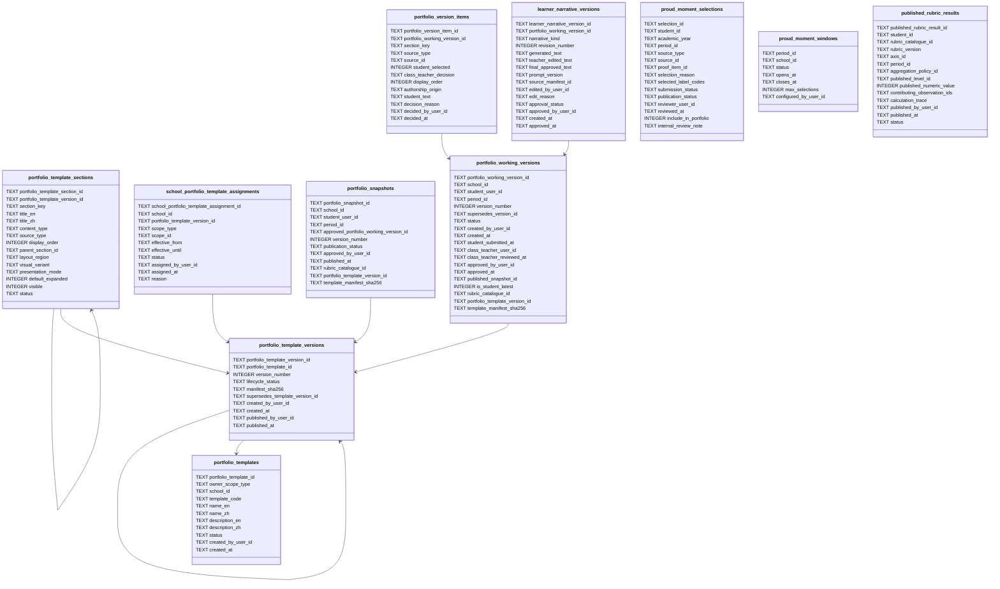

### V2 declared foreign keys across sections

Only declared foreign keys are listed. Each arrow is `table.column → referenced_table.column`; multiple columns pointing to one table are shown separately.

- **Identity, school, permissions and approval:** none declared.
- **Inputs, activities, forms and imports:** `activity_people.user_id` → `users.user_id`; `activity_label_assignments.assigned_by_user_id` → `users.user_id`; `activity_label_assignments.axis_id` → `rubric_axes.axis_id`; `activity_label_assignments.rubric_catalogue_id` → `rubric_catalogues.rubric_catalogue_id`; `assessment_assignments.assigned_by_user_id` → `users.user_id`; `assignment_recipients.subject_user_id` → `users.user_id`; `assignment_recipients.respondent_user_id` → `users.user_id`; `question_bank_versions.school_id` → `schools.school_id`; `question_blocks.school_id` → `schools.school_id`; `question_definitions.school_id` → `schools.school_id`; `source_systems.school_id` → `schools.school_id`; `import_batches.school_id` → `schools.school_id`; `activity_source_bindings.school_id` → `schools.school_id`; `definition_sources.school_id` → `schools.school_id`.
- **Processing, evidence, rubrics and AI:** `activity_dependency_impacts.triggered_by_user_id` → `users.user_id`; `activity_dependency_impacts.activity_id` → `activities.activity_id`; `activity_media.activity_id` → `activities.activity_id`; `media_assets.source_system_id` → `source_systems.source_system_id`; `media_assets.uploaded_by_user_id` → `users.user_id`; `media_assets.school_id` → `schools.school_id`; `external_media_references.source_system_id` → `source_systems.source_system_id`; `feedback.assessment_submission_id` → `assessment_submissions.assessment_submission_id`; `feedback.author_user_id` → `users.user_id`; `feedback.subject_user_id` → `users.user_id`; `feedback.activity_id` → `activities.activity_id`; `proof_items.student_id` → `users.user_id`; `rubric_catalogues.definition_source_id` → `definition_sources.definition_source_id`; `school_rubric_assignments.assigned_by_user_id` → `users.user_id`; `school_rubric_assignments.school_id` → `schools.school_id`; `ai_input_manifests.student_user_id` → `users.user_id`; `entity_lifecycle_events.actor_user_id` → `users.user_id`; `entity_lifecycle_events.school_id` → `schools.school_id`.
- **Portfolio and output:** `portfolio_templates.created_by_user_id` → `users.user_id`; `portfolio_templates.school_id` → `schools.school_id`; `portfolio_template_versions.published_by_user_id` → `users.user_id`; `portfolio_template_versions.created_by_user_id` → `users.user_id`; `school_portfolio_template_assignments.assigned_by_user_id` → `users.user_id`; `school_portfolio_template_assignments.school_id` → `schools.school_id`; `portfolio_snapshots.rubric_catalogue_id` → `rubric_catalogues.rubric_catalogue_id`; `portfolio_working_versions.rubric_catalogue_id` → `rubric_catalogues.rubric_catalogue_id`; `portfolio_working_versions.student_user_id` → `users.user_id`; `proud_moment_selections.student_id` → `users.user_id`; `published_rubric_results.published_level_id` → `rubric_levels.level_id`; `published_rubric_results.axis_id` → `rubric_axes.axis_id`; `published_rubric_results.rubric_catalogue_id` → `rubric_catalogues.rubric_catalogue_id`; `published_rubric_results.student_id` → `users.user_id`.

## Name-level inventory of extras and missing entity blocks

This is an exact-name inventory, not a compatibility score. A name in either list may have an equivalent under another name or in Core prose; no data should be removed on this basis.

**Core ER entity names without an identical V2 table (−V2 by name):** `activity_framework_targets`, `activity_instance_vask_items`, `activity_instances`, `activity_participants`, `activity_staff`, `activity_template_vask_items`, `activity_templates`, `activity_types`, `assessment_instruments`, `export_packages`, `feature_definitions`, `feedback_evidence`, `framework_skills`, `framework_steps`, `frameworks`, `group_memberships`, `groups`, `instrument_items`, `instrument_review_assignments`, `instrument_review_events`, `instrument_versions`, `media_access_grants`, `media_collection_items`, `media_collections`, `observation_evidence`, `portfolio_items`, `proof_type_definitions`, `proof_use_decisions`, `questionnaire_constructs`, `questions`, `response_scale_options`, `response_scales`, `school_feature_policies`, `vask_items`.

**V2 tables without an identical Core ER entity block (+V2 by name):** `activities`, `activity_dependency_impacts`, `activity_label_assignments`, `activity_people`, `activity_revision_risk_flags`, `activity_source_bindings`, `ai_candidate_decisions`, `ai_draft_candidates`, `ai_input_manifests`, `ai_manifest_sources`, `audit_events`, `definition_sources`, `entity_lifecycle_events`, `external_media_references`, `form_version_blocks`, `form_versions`, `import_batch_events`, `import_contract_versions`, `import_record_decisions`, `import_record_links`, `portfolio_template_sections`, `portfolio_template_versions`, `portfolio_templates`, `proud_moment_selections`, `proud_moment_windows`, `published_rubric_results`, `question_bank_versions`, `question_block_items`, `question_block_versions`, `question_blocks`, `question_definitions`, `question_versions`, `role_definition_versions`, `role_version_capabilities`, `rubric_axes`, `rubric_catalogues`, `rubric_groups`, `rubric_levels`, `rubric_step_definitions`, `school_portfolio_template_assignments`, `school_rubric_assignments`, `student_class_memberships`.

### Important mappings and discrepancies to verify

- `activity_instances` → `activities`; `activity_staff` and `activity_participants` → `activity_people` is an implementation merge. Verify each staff and attendance rule in services, not by name alone.
- Core has an older `activity_instance_vask_items` ER block and a later explicit `activity_label_assignments` responsibility in §9.1; V2 has `activity_label_assignments`. This is not simply an extra V2 table.
- Core `activity_revisions` lists `private_context`, `student_access_opens_at`, `student_access_closes_at` and `response_due_at`; V2 `activity_revisions` does not. `assessment_assignments.opens_at`/`due_at` exist, but are not automatically equivalent to every activity access window. V2 adds `requested_publisher_user_id`. Check routes and services before claiming a behavior gap.
- The SRS requires an activity code unique within school; V2 `activities` has `external_activity_id`, but the create schema does not declare a school-scoped unique constraint on that field. Whether it represents the SRS code and is enforced in a service requires verification.
- Core explicitly draws activity templates, framework targets, school feature policies and media access grants; there are no identically named V2 tables. Equivalent implementation and intended scope require verification, not an assumption of absence. Core proposes academic year/class structures; `academic_periods` has an `academic_year_id` value in V2 but this schema contains no `academic_years` table.
- Core mentions a general lifecycle/audit trail and approval history. V2 has `audit_events`, `entity_lifecycle_events`, approval records and revisions; confirm each transition actually writes all necessary events.
- V2 form, rubric and Portfolio-template tables are later detailed structures, some named in Core prose or CSV examples rather than its ER blocks. Some CSV records are examples, not operational imports. The schema does not prove end-to-end authoring, review or publication.

## Sources and method

- [Core data relationships](../../output/English/Core%20data%20relationships.md), especially entity ER blocks and §9.1; [Roles and permissions](../../output/English/Roles%20and%20permissions.md).
- [SRS index](../../output/English/SRS/README.md) and modules 01–13; [SRS-04 activity](../../output/English/SRS/SRS-04%20Activities%20participants%20and%20VASK.md).
- [CSV examples](../../output/import-examples/00_upload_manifest.csv), notably activity and people (04–05), forms (06–07), rubric and proof (24–31), permissions (43–50), Portfolio templates (62–65). Examples inform mappings; they are not assumed to be a database.
- [V2 create schema](../server/repositories/schema.js), executed in an in-memory SQLite database for schema introspection only. No working database was opened or changed. Generated diagrams are a dated snapshot and must be refreshed after schema changes.
- [V2 gap register](v2-documentation-and-schema-gap-register.md) records additional workflow and policy verification needed.
